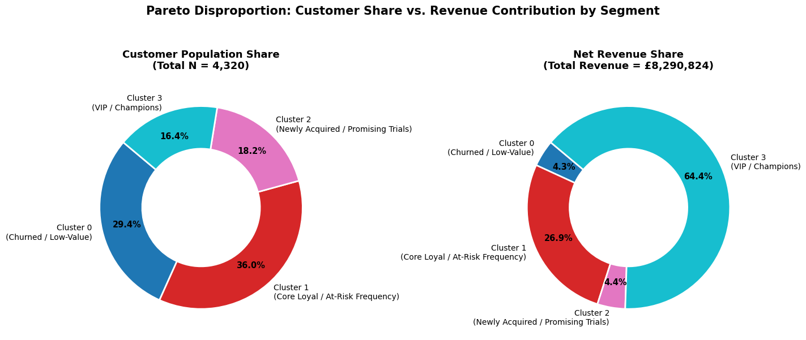
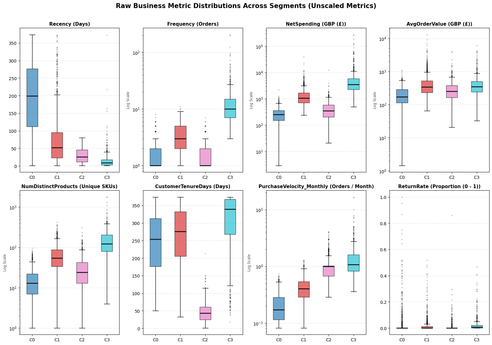
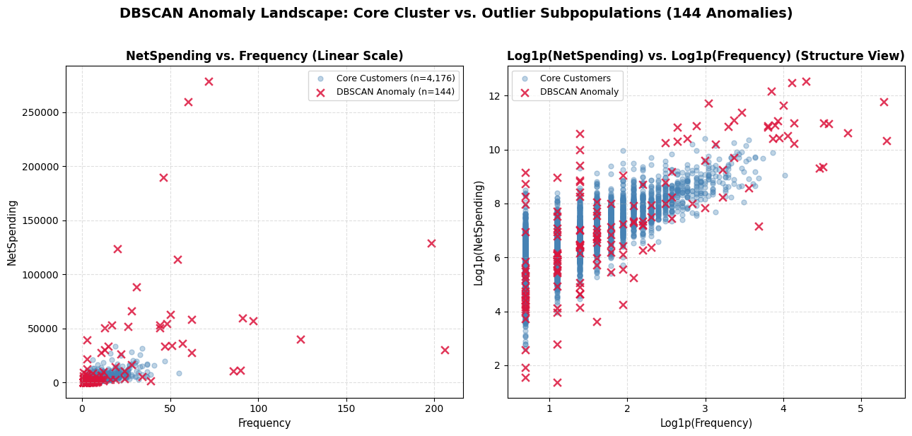
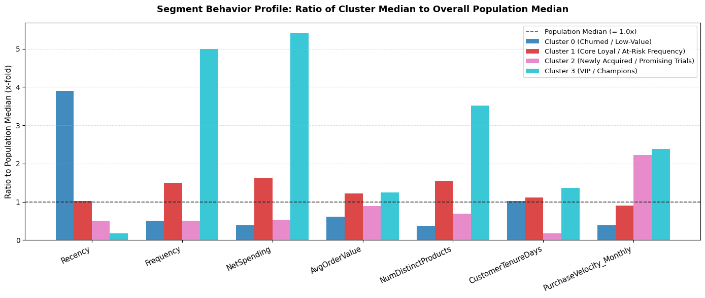

# Customer Segmentation & Explainable AI (XAI) Pipeline

An end-to-end customer intelligence and behavioral segmentation architecture on European online retail transaction records. The pipeline integrates extended RFM feature engineering, unsupervised clustering benchmarking (K-Means, Hierarchical, GMM, DBSCAN), multidimensional diagnostic profiling, and a white-box Global Surrogate Decision Tree with SHAP attribution and SQL rule compilation for zero-dependency production deployment.

---

## 1. Project Overview & Architecture Pipeline

The objective of this project is to partition an enterprise customer base into statistically validated, commercially actionable behavioral cohorts. The source dataset comprises **404,876 verified transaction records** spanning **21,785 purchase orders** and **4,320 unique customer accounts** across international and domestic European markets.

Rather than executing clustering directly on sparse or unaggregated transaction logs, the architecture engineers a stabilized customer-level feature store incorporating core RFM metrics (Recency, Frequency, Monetary spend) augmented by purchasing velocity, relationship tenure, catalog variety, basket scale, and cancellation propensity.

```
data/cleaned/retail_online.parquet (Transaction-level log: 404,876 rows)
   │
   ▼
src/feature_engineering.py (extract_customer_features)
   │
   ▼
notebook/eda.ipynb (Log1p transformation, collinearity audit, scaling, PCA)
   │
   ├─► data/clustered/customer_scaled.parquet (Standardized 8D matrix for clustering)
   └─► data/clustered/customer_raw_profiling.parquet (Unscaled real-world metrics for profiling)
         │
         ▼
src/clustering/ (K-Means k=4, Hierarchical, GMM, DBSCAN anomaly detection)
         │
         ▼
notebook/clustering.ipynb (Optimal K benchmarking, diagnostic profiling, cohort visualizer)
         │
         ▼
data/clustered/customer_segmented.parquet (Master customer table: clusters + anomaly tags)
         │
         ▼
src/surrogate/ (Surrogate Decision Tree, SHAP XAI, Rule Extraction, SQL Transpilation)
         │
         ▼
notebook/surrogate.ipynb (Fidelity evaluation, global/local SHAP attribution, 16 decision rules)
         │
         ▼
Production SQL CASE WHEN Query (Native warehouse deployment on BigQuery / Snowflake / Postgres)
```

---

## 2. Exploratory Data Analysis & Key Insights

Visual evidence generated in `notebook/eda.ipynb` and archived in `img/EDA/`.

### Geographic Structure and Domestic Dominance
- The United Kingdom accounts for 90.4% of unique customers, 89.9% of invoices, and 82.3% of total revenue.
- Non-UK accounts exhibit an Average Order Value of £664.14—nearly 1.9 times higher than domestic accounts (£348.45). International buyers consolidate orders into larger batches to offset international freight overhead.
- **Architectural Decision**: Geographic origin is retained as an auxiliary indicator (`IsUK`) rather than splitting the dataset into regional sub-models, preserving unified behavioral clustering.

### Feature Distributions and Skewness


- Raw monetary, frequency, and quantity metrics display severe positive skewness. Median net spending is £300.50, whereas wholesale accounts in the upper tail reach £278,778.02.
- Tail accounts represent genuine high-value B2B commercial entities rather than data corruption. Truncating or clipping upper percentiles would eliminate the business's most critical revenue engine.
- Interquartile ranges on raw scales collapse near zero, leaving distance-based algorithms vulnerable to tail domination.

### Multicollinearity Audit


- Spearman rank correlation analysis identified redundant feature pairs:
  - `NetSpending` and `GrossSpending` share a rank correlation of $r = 0.99$.
  - Return metrics (`ReturnRate`, `ReturnedAmount`, `CancelFrequency`) correlate at $r = 0.99 \text{ to } 1.00$.
  - Basket measures `AvgOrderValue` and `AvgItemsPerOrder` correlate at $r = 0.82$.
- **Architectural Decision**: Prune `GrossSpending`, `ReturnedAmount`, `CancelFrequency`, and `AvgItemsPerOrder` from the clustering space to eliminate artificial variance inflation along monetary and cancellation dimensions.

### Distortion in Raw Feature Space


- Standardizing raw features yields an unviable PCA projection: over 98% of customers collapse into an undifferentiated cluster at the origin, while extreme wholesale outliers stretch principal axes past 40.
- **Architectural Decision**: Standard distance-based clustering cannot be executed on raw features without prior variance stabilization.

### Log-Transformation and Scale Normalization


- Applying $\log(1 + x)$ compresses long tails and normalizes feature distributions:
  - `NetSpending` skewness decreases from 19.34 to 0.36.
  - `AvgOrderValue` skewness decreases from 36.38 to 0.01 (near-Gaussian symmetry).
  - `NumDistinctProducts` skewness decreases from 6.57 to -0.24.
  - `Frequency` and `PurchaseVelocity_Monthly` skewness decrease to 1.21 and 1.61, respectively.
- **Architectural Decision**: Substitute continuous raw metrics with their `_log1p` counterparts, followed by standard normalization (`StandardScaler`, $\mu = 0, \sigma = 1$).

### Revenue Concentration


- Revenue concentration follows an intense Pareto distribution: the top 27.8% of customers generate 80% of cumulative net revenue; the top 10% account for nearly half of total sales.
- **Architectural Decision**: Downstream clustering must cleanly isolate this high-value commercial minority for specialized key account workflows.

### RFM Value Distribution


- Active buyers (`Recency < 50` days) capture virtually all accounts with net spending exceeding £10,000 and elevated transaction cadence.
- Customers with `Recency > 200` days consist almost exclusively of single-order accounts with spend below £500, indicating customer churn.

### Customer Lifespan Geometry


- Plotting `CustomerTenureDays` against `Recency` delineates customer lifecycle stages:
  - The upper diagonal ($y = x$) contains one-time buyers whose tenure equals recency.
  - The lower triangle captures repeat purchasers.
  - The lower-right quadrant (`Tenure > 300`, `Recency < 30`) captures mature, active loyalists.
  - The central quadrant (`Tenure > 150`, `Recency > 100`) isolates lapsed accounts.
- **Architectural Decision**: Retain both `CustomerTenureDays` and `Recency` to distinguish account maturity from recent engagement.

### Return Behavior


- Return behavior is heavily zero-inflated: 63.6% of customer accounts have zero recorded returns.
- Among accounts with returns (36.4%), the vast majority exhibit low frictional return rates (< 5% of gross spend). A narrow tail displays severe return rates between 30% and 100%.
- **Architectural Decision**: Retain `ReturnRate_log1p` to isolate operational friction from routine volume purchasing.

### Buyer Typologies


- Mapping product variety (`NumDistinctProducts`) against order item volume (`AvgItemsPerOrder`) reveals four structural buyer profiles:
  - *Retail Buyers*: Low catalog variety and low unit counts.
  - *Bulk Wholesalers*: Narrow catalog focus with large unit order quantities.
  - *Assortment Retailers*: Broad catalog variety (> 50 SKUs) in moderate batch sizes.
  - *Enterprise Distributors*: Simultaneous broad catalog penetration and heavy order volumes.

---

## 3. Dimensionality Reduction on Final Features

Applying Principal Component Analysis (PCA) to the 8 selected, log-transformed, and standardized features yields an interpretable latent projection:

- **Variance Explained**:
  - PC1: 42.6% (Customer Engagement and Scale)
  - PC2: 22.6% (Account Maturity vs. Purchasing Cadence)
  - Cumulative variance of PC1 and PC2 captures **65.2%** of total variance; 3 components capture over **80%**.
- **Latent Component Semantics**:
  - **PC1 (Scale & Engagement)**: Positive loadings on `NetSpending_log1p` (0.51), `Frequency_log1p` (0.47), `NumDistinctProducts_log1p` (0.44), `PurchaseVelocity_Monthly_log1p` (0.30), and `AvgOrderValue_log1p` (0.29); negative loading on `Recency_log1p` (-0.38).
  - **PC2 (Maturity vs. Velocity)**: Positive loadings on `CustomerTenureDays_log1p` (0.68) and `Recency_log1p` (0.37); negative loading on `PurchaseVelocity_Monthly_log1p` (-0.56).
  - **PC3 (Orthogonal Return Dimension)**: `ReturnRate_log1p` carries negligible weight on PC1 (-0.02) and PC2 (0.05), loading into PC3. Return propensity acts independently of customer monetary value and account age.

---

## 4. Preprocessing & Boundary Stabilization Decisions

1. **Floating-Point Boundary Cleanup**:
   Calculations of `NetSpending = GrossSpending - ReturnedAmount` were rounded to 2 decimal places. This eliminates floating-point precision noise ($10^{-14}$) from 100% cancellation accounts, strictly enforcing the `NetSpending > 0` filter.
2. **Velocity Denominator Stabilization**:
   In `PurchaseVelocity_Monthly = Frequency / (CustomerTenureDays / 30.4375)`, tenure is lower-bounded at 1.0 month. This prevents single-purchase accounts created in the final days of the observation window from displaying artificial velocity spikes of 30+ orders per month.
3. **Outlier Retention Strategy**:
   Extreme values in RFM features represent real B2B commercial organizations. Rather than discarding or winsorizing upper tails, features are stabilized via $\log(1 + x)$ followed by `StandardScaler`.
4. **Primary Key Traceability**:
   `CustomerID` is retained across all pipeline artifacts as a primary key, ensuring cluster labels map cleanly to unscaled business metrics.

---

## 5. Exported Datasets & Feature Stores

All engineered data artifacts reside in `data/clustered/`:

### 1. Standardized Clustering Matrix (`data/clustered/customer_scaled.parquet`)
Contains 4,320 rows with `CustomerID` and 8 standardized dimensions ($\mu = 0, \sigma = 1$):
`Recency_scaled`, `Frequency_scaled`, `NetSpending_scaled`, `AvgOrderValue_scaled`, `NumDistinctProducts_scaled`, `CustomerTenureDays_scaled`, `PurchaseVelocity_Monthly_scaled`, `ReturnRate_scaled`.

### 2. Unscaled Business Profiling Matrix (`data/clustered/customer_raw_profiling.parquet`)
Contains 4,320 rows with `CustomerID` and 12 unscaled business metrics (GBP currency, order counts, days, ratios) to enable diagnostic profiling without scaling distortion.

### 3. Segmented Customer Master Table (`data/clustered/customer_segmented.parquet`)
Master analytical table merging the 12 unscaled profiling metrics with final K-Means ($K = 4$) cluster labels, persona descriptors, and DBSCAN outlier tags:
- `CustomerID`: Unique identifier.
- 12 raw behavioral metrics (`Recency`, `Frequency`, `NetSpending`, `AvgOrderValue`, `NumDistinctProducts`, `CustomerTenureDays`, `PurchaseVelocity_Monthly`, `ReturnRate`, `GrossSpending`, `ReturnedAmount`, `CancelFrequency`, `IsUK`).
- `Cluster`: Integer cluster identifier (`0, 1, 2, 3`).
- `Cluster_Name`: Business persona descriptor (`VIP / Champions`, `Core Loyal / At-Risk Frequency`, `Newly Acquired / Promising Trials`, `Churned / Low-Value`).
- `Is_Anomaly`: Binary outlier flag (`1` for DBSCAN density outliers, `0` otherwise).

---

## 6. Unsupervised Clustering & Model Benchmarking

Clustering experiments, diagnostic sweeps, and visual validations are executed in `notebook/clustering.ipynb` using `src/clustering/`.

### Algorithm Benchmarking at K = 4
Four clustering paradigms were evaluated on the 8 standardized dimensions: K-Means, Agglomerative Hierarchical (Ward linkage), Gaussian Mixture Models (GMM with full covariance), and DBSCAN (`eps = 1.5`, `min_samples = 10`).


| Algorithm | Clusters ($k$) | Noise (%) | Silhouette Score | Davies-Bouldin Index | Calinski-Harabasz Index | Min Cluster Size (%) | Max Cluster Size (%) |
| :--- | :---: | :---: | :---: | :---: | :---: | :---: | :---: |
| **K-Means** | **4** | **0.00%** | **0.2403** | **1.2992** | **1376.3** | **16.44%** | **35.97%** |
| Hierarchical | 4 | 0.00% | 0.1729 | 1.4833 | 1090.2 | 17.25% | 33.15% |
| GMM | 4 | 0.00% | 0.0740 | 2.7201 | 661.5 | 16.69% | 34.28% |
| DBSCAN | 1 | 3.33% | N/A | N/A | N/A | 96.67% | 96.67% |

- **K-Means** delivers the highest Silhouette score (0.2403), lowest Davies-Bouldin index (1.2992), and highest Calinski-Harabasz index (1376.3), forming distinct Voronoi partitions across all four quadrants of the latent PCA space.
- **Hierarchical Clustering** identifies similar macroscopic quadrants but creates jagged boundaries near transition corridors.
- **GMM** exhibits heavy spatial overlap on the primary plane because covariance ellipsoids align with orthogonal return variance (PC3) rather than monetary and lifecycle scale.
- **DBSCAN** collapses 96.67% of accounts into a single connected core because retail purchasing forms a continuous density gradient. Tightening `eps` classifies up to 45% of active customers as noise.
- **Decision**: Select K-Means ($K = 4$) as the primary segmentation engine. Repurpose DBSCAN noise (-1) as an auxiliary `Is_Anomaly` tag to audit commercial super-whales and high-frequency returners.

### Parameter Optimization & Convergence


- **K-Means**: Inertia exhibits a continuous elbow trajectory. The Davies-Bouldin index attains a local optimum at $K = 4$ (1.2992), outperforming $K = 3$ (1.3512).
- **Hierarchical**: The Ward dendrogram demonstrates two prominent merge gaps: distance ~86 ($K = 2$) and distance ~35 to ~53 ($K = 3 \text{ to } 4$). Merges below distance 25 represent micro-fragmentation.
- **DBSCAN**: The sorted 10-NN distance curve remains flat below 1.2 across 95% of accounts before curving upward at the knee point of 1.5, isolating 144 anomaly accounts.

### Validation of K = 4 vs. K = 3
To confirm that $K = 4$ offers genuine behavioral differentiation over $K = 3$, clusters were evaluated across all 8 dimensions using Snake Plots and Polar Radar Charts:


- **Behavioral Differentiation**: Transitioning from $K = 3$ to $K = 4$ separates the broad middle tier into two distinct behavioral profiles crossing at `AvgOrderValue`:
  - **Cluster 1 (Core Loyal)**: Average Order Value $Z$-score reaches +0.41 (median £345.16), matching the basket value of VIPs (Cluster 3, median £354.05). However, purchase frequency remains moderate (median 3 orders) and monthly velocity dips below average ($Z = -0.30$).
  - **Cluster 0 (Churned)**: Collapses across all commercial dimensions (Net Spend $Z = -0.91$, AOV $Z = -0.65$, Recency $Z = +0.95$).
- **Geometric Signature**: Radar plots verify that $K = 4$ forms four distinct directional polygons: Cluster 3 spans all monetary/volume axes; Cluster 1 anchors order value and tenure; Cluster 0 extends purely along recency; and Cluster 2 extends along velocity.

---

## 7. Customer Profiling & Behavioral Persona Analysis

Mapped unscaled metrics in `customer_segmented.parquet` were analyzed via `src/profiling/` in `notebook/clustering.ipynb`.

### Revenue Concentration & Macro Distribution


Cumulative net sales across 4,320 customer accounts reach **£8,290,824**:

- **Cluster 3 (VIP / Champions)**: Accounts for **16.44%** of the customer population ($n = 710$) but captures **64.40%** of total net sales (£5,339,172).
- **Cluster 1 (Core Loyal / At-Risk Frequency)**: Accounts for **35.97%** of the population ($n = 1,554$) and generates **26.92%** of net sales (£2,231,646).
- **Commercial Backbone**: Together, Clusters 3 and 1 represent **52.41%** of accounts ($n = 2,264$) but drive **91.32%** of net revenue (£7,570,818).
- **The Long Tail**: In contrast, Clusters 0 and 2 account for **47.59%** of accounts ($n = 2,056$) but contribute only **8.68%** of revenue (£720,006).

### Unscaled Real-World Metric Distributions


- **Recency (Days)**: Cluster 3 transacts continuously (median 9.0 days); Cluster 2 captures recent trial accounts (median 26.0 days); Cluster 1 sits in an active consideration window (median 52.0 days); and Cluster 0 is in deep dormancy (median 199.0 days).
- **Frequency & Monetary Spend**: Cluster 3 operates at commercial scale (median 10.0 orders, median spend £3,541.01, mean spend £7,519.96). Cluster 1 represents reliable repeat buyers (median 3.0 orders, median spend £1,068.53).
- **Average Order Value (AOV) Parity**: Unscaled AOV distributions confirm that Cluster 1 (median £345.16) matches Cluster 3 (median £354.05). Cluster 1 customers buy in full wholesale batches but purchase 3 times per year rather than 10 times. Growth in this segment relies on purchasing cadence rather than basket expansion.
- **Catalog Penetration (`NumDistinctProducts`)**: Product variety scales progressively from Cluster 0 (median 13.0 SKUs) to Cluster 2 (median 24.0 SKUs), Cluster 1 (median 54.0 SKUs), and Cluster 3 (median 123.0 SKUs).
- **Relationship Lifespan & Velocity**: Cluster 2 captures newly acquired customers (median tenure 43.0 days) exhibiting rapid initial velocity (median 1.00 order/month). Cluster 0 captures older accounts (median tenure 254.0 days) that failed to repurchase, dropping velocity to 0.17 orders/month.

### DBSCAN Anomaly Audit: B2B Super-Whales vs. Cancellation Risks


DBSCAN identified 144 outlier accounts (3.33% of the customer base) forming two structural sub-cohorts:
- **Wholesale Super-Whales** (55 accounts in Cluster 3): Enterprise buyers with spending exceeding £100,000 (e.g., Customer 14646: £278,778 spend across 72 orders; Customer 18102: £259,657 spend across 60 orders; Customer 14911: £128,882 spend across 198 orders).
- **Operational Friction & Chronic Returners** (43 accounts in Cluster 0, 24 in Cluster 1): Accounts where return volumes severely offset gross sales (e.g., Customer 16446: £168,469 returned with a 99.9% return rate; Customer 15749: £22,998 returned).

### Behavioral Multipliers Relative to Population Baseline


Normalizing cluster medians against the population median (1.0x baseline):
- **Cluster 3 (VIP)**: Net Spending is 5.42x baseline; Frequency is 5.00x; SKU Variety is 3.51x; Velocity is 2.38x; Recency is 0.18x (over 5x more recent).
- **Cluster 1 (Core Loyal)**: Net Spending is 1.63x; SKU Variety is 1.55x; AOV is 1.23x; Tenure is 1.11x; Monthly Velocity declines to 0.91x (cadence deceleration).
- **Cluster 2 (Newly Acquired)**: Customer Tenure is 0.17x baseline, yet Monthly Velocity reaches 2.22x (strong onboarding momentum).
- **Cluster 0 (Churned)**: Recency is 3.90x baseline (inactivity), while Net Spending drops to 0.38x.

### Cohort Summary Table

| Cluster | Persona | Customers | Customer Share | Net Revenue | Revenue Share | Median Recency | Median Frequency | Median Net Spend | Median AOV | Median SKUs | Median Velocity |
| :---: | :--- | :---: | :---: | :---: | :---: | :---: | :---: | :---: | :---: | :---: | :---: |
| **3** | **VIP / Champions** | 710 | 16.44% | £5,339,172 | 64.40% | 9 days | 10 orders | £3,541.01 | £354.05 | 123 | 1.07 / mo |
| **1** | **Core Loyal / At-Risk Frequency** | 1,554 | 35.97% | £2,231,646 | 26.92% | 52 days | 3 orders | £1,068.53 | £345.16 | 54 | 0.40 / mo |
| **2** | **Newly Acquired / Promising Trials** | 786 | 18.19% | £367,572 | 4.43% | 26 days | 1 order | £351.12 | £252.99 | 24 | 1.00 / mo |
| **0** | **Churned / Low-Value** | 1,270 | 29.40% | £352,434 | 4.25% | 199 days | 1 order | £252.33 | £172.12 | 13 | 0.17 / mo |

---

## 8. Explainable AI (XAI) & Global Surrogate Decision Tree Modeling

Implemented in `src/surrogate/` and executed in `notebook/surrogate.ipynb`.

### Problem Formulation: Unsupervised Black-Box to Transparent Logic
Unsupervised K-Means clustering partitions customers based on Euclidean distance in an 8-dimensional normalized feature space. While mathematically sound, this creates operational friction:
- **Opacity**: Business stakeholders cannot audit normalized Euclidean centroid boundaries on raw customer data.
- **Deployment Overhead**: Scoring incoming transactions requires preserving preprocessing scalers and running Python ML inference containers.
- **Surrogate Solution**: A shallow, entropy-based **Decision Tree Classifier** is trained as a Global Surrogate model directly on unscaled transaction features to approximate K-Means cluster assignments, optimizing for **Fidelity** while maintaining strict rule simplicity.

### Hyperparameter & Depth Optimization


A grid evaluation of tree depths (`max_depth` from 3 to 6) was conducted using Stratified 5-Fold Cross-Validation:

| Max Depth | Fidelity Accuracy (Mean %) | Std (%) | Macro F1-Score | Terminal Leaves (Rules) | Complexity Assessment |
| :---: | :---: | :---: | :---: | :---: | :--- |
| **3** | 85.35% | ±0.94% | 0.8554 | 8 | Coarse grouping; merges boundary segments |
| **4 (Selected)** | **87.06%** | **±1.31%** | **0.8726** | **16** | **Optimal Elbow Point: ~87% Fidelity across 16 human-auditable rules** |
| **5** | 89.31% | ±0.92% | 0.8924 | 28 | Complexity increases by 75% for a minor +2.25% accuracy gain |
| **6** | 90.14% | ±1.27% | 0.8996 | 43 | Excessive rule fragmentation (43 leaves); risk of overfitting cluster borders |

- Constraining `max_depth = 4` and `min_samples_leaf = 20` yields exactly 16 rules (averaging 4 rules per customer persona), achieving structural simplicity without statistical degradation.

### 5-Fold Stratified Cross-Validation & Confusion Matrix


Cross-validation across all 4,320 customer accounts demonstrates robust surrogate fidelity:
- **Overall Fidelity Accuracy**: `87.06%`
- **Balanced Accuracy**: `87.53%`
- **Macro F1-Score**: `0.8729`

#### Per-Persona Classification Performance:
- **Cluster 0 (Churned / Low-Value)**: Precision 0.880, Recall 0.906, F1 0.893 (Support: 1,270).
- **Cluster 1 (Core Loyal / At-Risk Frequency)**: Precision 0.861, Recall 0.831, F1 0.845 (Support: 1,554).
- **Cluster 2 (Newly Acquired / Promising Trials)**: Precision 0.905, Recall 0.882, F1 0.893 (Support: 786).
- **Cluster 3 (VIP / Champions)**: Precision 0.839, Recall 0.883, F1 0.861 (Support: 710).

*Confusion Matrix Dynamics*: Classification error is primarily confined to the boundary between *Core Loyal* and *VIP / Champions*. This reflects continuous customer lifecycle progression where top-tier Core Loyal accounts transition into VIP spending ranges.

### Feature Attribution: Tree Impurity vs. SHAP Global Attribution


Evaluating feature attribution via internal Gini impurity reduction and model-agnostic SHAP values:

| Feature Name | Tree Importance (Gini) | Global SHAP Attribution | Behavioral Function |
| :--- | :---: | :---: | :--- |
| **NetSpending** | **38.66%** | **35.59%** | **Primary Financial Lever**: Separates low-tier from high-value tiers |
| **PurchaseVelocity_Monthly** | **22.14%** | **20.73%** | **Transaction Cadence**: Captures normalized purchasing momentum |
| **CustomerTenureDays** | **20.45%** | **18.32%** | **Account Age**: Separates new trial accounts from mature accounts |
| **Frequency** | 9.59% | 11.53% | Cumulative order engagement count |
| **Recency** | 5.23% | 8.50% | Inactivity warning signal (Days since last interaction) |
| **NumDistinctProducts** | 3.79% | 5.26% | Catalog penetration and SKU breadth |
| **AvgOrderValue (AOV)** | 0.14% | 0.07% | Redundant signal; largely captured by $NetSpending / Frequency$ |
| **ReturnRate** | 0.00% | 0.00% | Zero-inflated; lacks variance across core customer tiers |

- The top three features (`NetSpending`, `PurchaseVelocity_Monthly`, `CustomerTenureDays`) account for over **81%** of total splitting power and attribution mass.
- Strong rank concordance between Gini and SHAP values verifies that decision splits reflect genuine data variance rather than correlation artifacts.

### Local Cohort Interpretability (SHAP Beeswarm)


- **VIP / Champions (Cluster 3)**: Driven positively by high `NetSpending` (large positive SHAP values), high `PurchaseVelocity_Monthly` (> 0.9 orders/month), and elevated `Frequency`. `Recency` exerts negative impact when high, reinforcing that VIP status requires continuous purchasing.
- **Churned / Low-Value (Cluster 0)**: Driven primarily by low `NetSpending`, elevated `Recency` (> 80 days), and low `CustomerTenureDays` or low velocity.

### Deterministic Decision Rules
The decision tree translates into **16 mutually exclusive IF-THEN rules**, achieving **88.29% fidelity** on the complete dataset with an average rule length of **4.0 conditions**:

#### High-Confidence Rules (Confidence > 96%):
- **Rule 10 $\rightarrow$ `Newly Acquired / Promising Trials` (Confidence: 100.0%, Support: 412 accounts)**:
  `NetSpending <= 521.52 AND CustomerTenureDays <= 75.50 AND PurchaseVelocity_Monthly > 0.55 AND AvgOrderValue > 68.76`
  *Profile*: Accounts joined within the last 2.5 months displaying active purchasing cadence and healthy basket sizes.
- **Rule 01 $\rightarrow$ `Churned / Low-Value` (Confidence: 99.27%, Support: 959 accounts)**:
  `NetSpending <= 521.52 AND CustomerTenureDays > 75.50 AND Recency > 80.50 AND NumDistinctProducts <= 55.50`
  *Profile*: Mature accounts (> 75 days) with low spend, prolonged inactivity (> 80 days), and narrow catalog exploration.
- **Rule 05 $\rightarrow$ `Core Loyal / At-Risk Frequency` (Confidence: 97.81%, Support: 822 accounts)**:
  `NetSpending > 521.52 AND PurchaseVelocity_Monthly <= 0.66 AND NumDistinctProducts > 36.50 AND Frequency <= 5.50`
  *Profile*: Valuable accounts (> £521 spend) exploring diverse products, but experiencing decelerating velocity ($\le 0.66$ orders/month).
- **Rule 15 $\rightarrow$ `VIP / Champions` (Confidence: 96.34%, Support: 464 accounts)**:
  `NetSpending > 521.52 AND PurchaseVelocity_Monthly > 0.66 AND Frequency > 4.50 AND PurchaseVelocity_Monthly > 0.90`
  *Profile*: Star segment: High lifetime spending, repeat transaction history (> 4.5 orders), and steady cadence approaching 1 order per month.

#### Boundary & Transition Rules (Confidence: 51% – 66%):
- Rules with lower purity (e.g., Rule 04, Rule 07, Rule 13) capture transitional customer states:
  - Accounts with spend > £521 that exhibit a sharp drop in recency (> 80 days dormant) represent the transition corridor between **Core Loyal** and **Churned**.
  - New sign-ups with low velocity and low basket values are at imminent risk of churning immediately following their first trial.

### Production Deployment via SQL Compilation
The 16 deterministic decision rules transpile directly into native SQL `CASE WHEN` logic, executable on any Data Warehouse (BigQuery, Snowflake, PostgreSQL) without external ML dependencies:

```sql
SELECT
    CustomerID,
    Recency,
    Frequency,
    NetSpending,
    AvgOrderValue,
    NumDistinctProducts,
    CustomerTenureDays,
    PurchaseVelocity_Monthly,
    ReturnRate,
    CASE
        WHEN NetSpending <= 521.520 AND CustomerTenureDays <= 75.500 AND PurchaseVelocity_Monthly <= 0.552 AND NumDistinctProducts <= 17.500 THEN 'Churned / Low-Value'
        WHEN NetSpending <= 521.520 AND CustomerTenureDays <= 75.500 AND PurchaseVelocity_Monthly <= 0.552 AND NumDistinctProducts > 17.500 THEN 'Newly Acquired / Promising Trials'
        WHEN NetSpending <= 521.520 AND CustomerTenureDays <= 75.500 AND PurchaseVelocity_Monthly > 0.552 AND AvgOrderValue <= 68.755 THEN 'Churned / Low-Value'
        WHEN NetSpending <= 521.520 AND CustomerTenureDays <= 75.500 AND PurchaseVelocity_Monthly > 0.552 AND AvgOrderValue > 68.755 THEN 'Newly Acquired / Promising Trials'
        WHEN NetSpending <= 521.520 AND CustomerTenureDays > 75.500 AND Recency <= 80.500 AND NetSpending <= 248.640 THEN 'Churned / Low-Value'
        WHEN NetSpending <= 521.520 AND CustomerTenureDays > 75.500 AND Recency <= 80.500 AND NetSpending > 248.640 THEN 'Core Loyal / At-Risk Frequency'
        WHEN NetSpending <= 521.520 AND CustomerTenureDays > 75.500 AND Recency > 80.500 AND NumDistinctProducts <= 55.500 THEN 'Churned / Low-Value'
        WHEN NetSpending <= 521.520 AND CustomerTenureDays > 75.500 AND Recency > 80.500 AND NumDistinctProducts > 55.500 THEN 'Core Loyal / At-Risk Frequency'
        WHEN NetSpending > 521.520 AND PurchaseVelocity_Monthly <= 0.659 AND NumDistinctProducts <= 36.500 AND NetSpending <= 946.800 THEN 'Churned / Low-Value'
        WHEN NetSpending > 521.520 AND PurchaseVelocity_Monthly <= 0.659 AND NumDistinctProducts <= 36.500 AND NetSpending > 946.800 THEN 'Core Loyal / At-Risk Frequency'
        WHEN NetSpending > 521.520 AND PurchaseVelocity_Monthly <= 0.659 AND NumDistinctProducts > 36.500 AND Frequency <= 5.500 THEN 'Core Loyal / At-Risk Frequency'
        WHEN NetSpending > 521.520 AND PurchaseVelocity_Monthly <= 0.659 AND NumDistinctProducts > 36.500 AND Frequency > 5.500 THEN 'VIP / Champions'
        WHEN NetSpending > 521.520 AND PurchaseVelocity_Monthly > 0.659 AND Frequency <= 4.500 AND CustomerTenureDays <= 122.500 THEN 'Newly Acquired / Promising Trials'
        WHEN NetSpending > 521.520 AND PurchaseVelocity_Monthly > 0.659 AND Frequency <= 4.500 AND CustomerTenureDays > 122.500 THEN 'Core Loyal / At-Risk Frequency'
        WHEN NetSpending > 521.520 AND PurchaseVelocity_Monthly > 0.659 AND Frequency > 4.500 AND PurchaseVelocity_Monthly <= 0.902 THEN 'VIP / Champions'
        WHEN NetSpending > 521.520 AND PurchaseVelocity_Monthly > 0.659 AND Frequency > 4.500 AND PurchaseVelocity_Monthly > 0.902 THEN 'VIP / Champions'
        ELSE 'Unclassified'
    END AS Segment_Persona
FROM online_retail_customer_features;
```

- **Zero Inference Latency**: Eliminates the need for microservice infrastructure or Dockerized Python runtimes. Scoring operates at SQL query execution speeds across customer tables.
- **Real-Time Integration**: Direct scoring on live database views and enterprise BI dashboards (Looker, Tableau, PowerBI).

---

## 9. Strategic Action Playbook & Lifecycle Governance

### 1. Persona-Specific Playbooks

#### Cluster 3: VIP / Champions
- **Strategic Focus**: Contract lock-in, proactive retention, and fulfillment priority.
- **Execution**: Assign dedicated B2B Key Account Managers, introduce volume rebates, provide priority warehouse inventory allocation, and establish automated EDI replenishment.
- **Target KPIs**: 0% voluntary churn among accounts with annual spend > £10,000; Net Revenue Retention (NRR) > 115%.

#### Cluster 1: Core Loyal / At-Risk Frequency
- **Strategic Focus**: Purchase frequency acceleration and catalog cross-selling.
- **Execution**: Deploy automated replenishment reminders between days 45 and 60 post-purchase. Provide tiered freight discounts for multi-category purchases to expand catalog penetration from 54 SKUs toward VIP levels (120+ SKUs).
- **Target KPIs**: Increase order frequency from 3 to 5 orders per year; achieve 15% annual graduation rate into Cluster 3.

#### Cluster 2: Newly Acquired / Promising Trials
- **Strategic Focus**: Second-order conversion within the initial 60-day window.
- **Execution**: Automated 30-60-90 day onboarding drip sequence, targeted second-purchase incentives, and curated starter kits based on initial order SKUs.
- **Target KPIs**: Second-purchase conversion rate > 40% before day 60; transition 25% of trial accounts into Cluster 1.

#### Cluster 0: Churned / Low-Value
- **Strategic Focus**: Zero-marginal-cost opportunistic win-back.
- **Execution**: Suppress paid retargeting and dedicated outbound sales. Limit outreach to automated seasonal clearance campaigns (Q4 holiday promotions and clearance events).
- **Target KPIs**: Automated email reactivation rate of 5% to 8%; zero incremental paid marketing spend.

### 2. Operational Model Governance & Drift Monitoring
- **Threshold & Concept Drift**: The 16 split thresholds reflect current purchasing distributions. Macroeconomic shifts (inflation shifting spend thresholds) or seasonal volatility (Q4 retail spikes) can cause threshold drift.
- **Retraining Cadence**: Re-cluster via K-Means and retrain the Surrogate Decision Tree on a **quarterly** or **bi-annual** schedule to keep decision boundaries aligned with customer behavioral distributions.

---

## 10. Repository Architecture

```
customer-segmentation/
├── data/
│   ├── cleaned/
│   │   └── retail_online.parquet             # Cleaned transaction logs (404,876 rows)
│   ├── clustered/
│   │   ├── customer_scaled.parquet           # Standardized 8D matrix for clustering
│   │   ├── customer_raw_profiling.parquet    # Unscaled real-world metrics for profiling
│   │   └── customer_segmented.parquet        # Master table (clusters + anomaly tags)
│   ├── online_retail.xlsx                    # Raw dataset
│   └── README.md                             # Data documentation
├── img/
│   ├── EDA/                                  # EDA visual evidence (img1.png to img10.png)
│   ├── Clustering/                           # Clustering diagnostic charts (img1.png to img7.png)
│   ├── Profilling/                           # Customer profiling charts (img1.png to img4.png)
│   └── Surrogate Model/                      # Surrogate model diagnostics (img1.png to img6.png)
│       ├── img1.png                          # Decision tree depth tuning curve
│       ├── img2.png                          # 5-fold cross-validation confusion matrix
│       ├── img3.png                          # Gini feature importance bar chart
│       ├── img4.png                          # Global multiclass SHAP summary plot
│       ├── img5.png                          # VIP / Champions cohort SHAP beeswarm
│       └── img6.png                          # Churned / Low-Value cohort SHAP beeswarm
├── notebook/
│   ├── cleaning.ipynb                        # Transaction-level data cleaning
│   ├── eda.ipynb                             # Feature engineering, EDA, scaling, export
│   ├── clustering.ipynb                      # Clustering benchmarking, optimal K, customer profiling
│   └── surrogate.ipynb                       # Decision tree surrogate, SHAP XAI, rule extraction
├── src/
│   ├── clustering/                           # Clustering package
│   │   ├── algorithms.py                     # K-Means, GMM, Hierarchical, DBSCAN runners
│   │   ├── evaluation.py                     # Metrics calculation and parameter sweeps
│   │   ├── visualization.py                  # PCA, dendrogram, knee, snake, and radar plots
│   │   └── __init__.py                       # Package interface
│   ├── profiling/                            # Customer profiling package
│   │   ├── mapping.py                        # Segmented dataset assembly and persistence
│   │   ├── statistics.py                     # Revenue share, summary cards, anomaly audit
│   │   ├── visualization.py                  # Pareto donuts, boxplots, anomaly scatter, multipliers
│   │   └── __init__.py                       # Package interface
│   ├── surrogate/                            # Explainable AI & Surrogate package
│   │   ├── trainer.py                        # DecisionTreeSurrogateModel trainer & CV evaluator
│   │   ├── explainability.py                 # SurrogateSHAPExplainer (global/local attribution)
│   │   ├── rule_extractor.py                 # DecisionTreeRuleExtractor & SQL CASE WHEN compiler
│   │   ├── visualization.py                  # Tuning curves, confusion matrices, SHAP plots
│   │   └── __init__.py                       # Package interface
│   ├── feature_engineering.py                # Customer aggregation and transformation
│   └── visualization.py                      # EDA plotting and PCA utilities
├── .gitignore
└── README.md                                 # End-to-end project documentation
```
