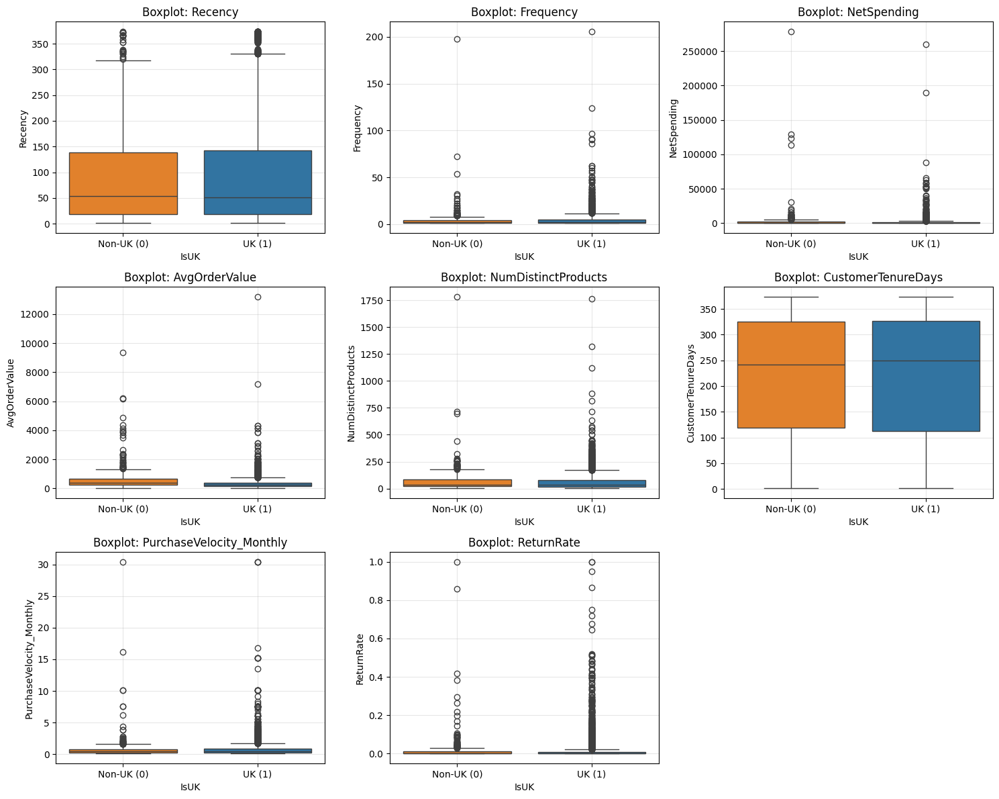
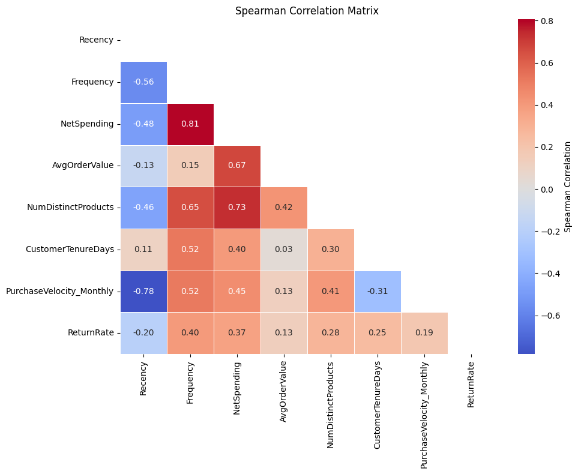
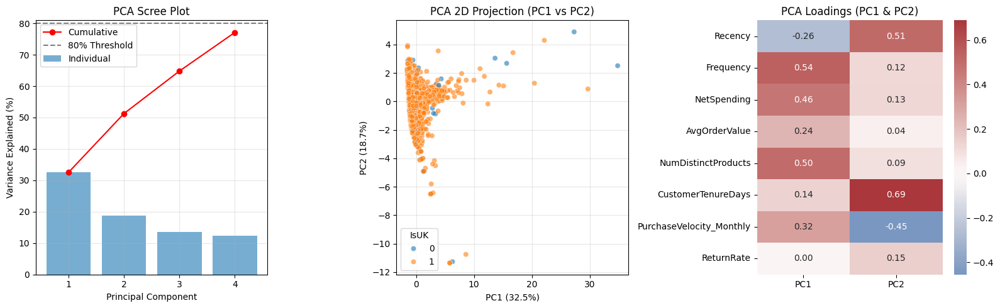
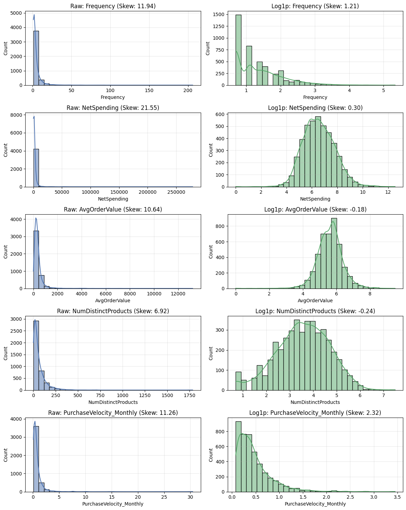
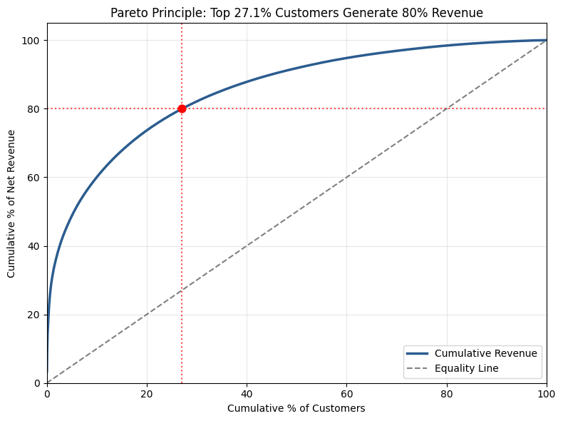
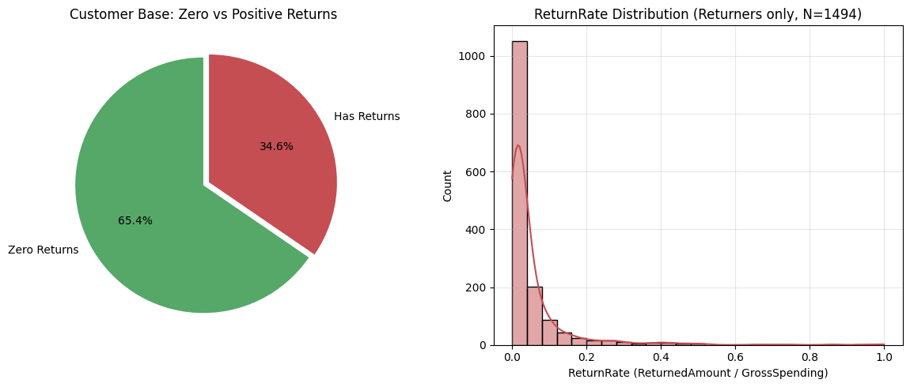
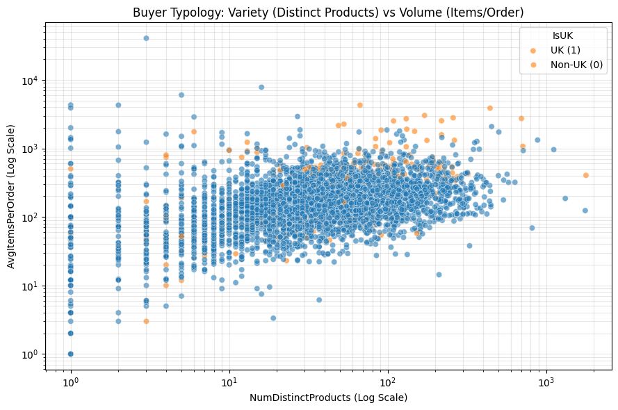

# Customer Segmentation

A customer segmentation pipeline on the Online Retail transaction dataset using extended RFM modeling, exploratory data analysis, and feature engineering to prepare customer representations for unsupervised clustering and subsequent customer profiling.

---

## 1. Project Overview

The objective of this project is to segment customers of an online retail platform into distinct, actionable behavioral cohorts. The source dataset comprises 404,876 cleaned transaction records spanning 21,785 orders and 4,362 unique customer identifiers from European online retail operations.

Rather than clustering raw, unaggregated transaction rows, the pipeline establishes a structured customer-level feature store. It incorporates core RFM metrics (Recency, Frequency, Monetary value) along with basket volume, product variety, customer tenure, order velocity, and return behavior.

```
data/cleaned/retail_online.parquet (Transaction level)
   │
   ▼
src/feature_engineering.py (extract_customer_features)
   │
   ▼
notebook/eda.ipynb (Distribution analysis, collinearity audit, log transformation, PCA, scaling)
   │
   ├─► data/clustered/customer_scaled.parquet (Scaled feature matrix for clustering)
   └─► data/clustered/customer_raw_profiling.parquet (Unscaled real-world metrics for profiling)
```

---

## 2. Exploratory Data Analysis and Key Insights

All visual evidence referenced below is generated in `notebook/eda.ipynb` and archived in the `img/` directory.

### Geographic Structure and Domestic Dominance
- The United Kingdom accounts for 90.4% of unique customers, 89.9% of invoices, and 82.3% of total revenue.
- Non-UK accounts exhibit an Average Order Value of 664.14, nearly 1.9 times higher than UK accounts (348.45). International buyers tend to consolidate orders into larger baskets to offset cross-border freight costs.
- Decision: Because behavioral patterns are structurally similar across territories aside from basket scale, geographic origin is retained as an auxiliary profiling flag (`IsUK`) rather than splitting the dataset into separate models.

### Feature Distributions and Skewness



- Raw spending, frequency, and quantity features exhibit severe right-skewness. Median net spending is 300.50, whereas wholesale accounts in the tail reach 278,778.02.
- Outliers in these features represent genuine B2B and institutional accounts rather than data collection errors. Dropping or winsorizing upper percentiles would discard the business's most valuable customer tier.
- Interquartile ranges on raw scales collapse near zero, leaving distance-based algorithms vulnerable to tail domination.

### Multicollinearity Audit


- A Spearman rank correlation matrix identified redundant metrics:
  - `NetSpending` and `GrossSpending` share a correlation of r = 0.99.
  - Return metrics (`ReturnRate`, `ReturnedAmount`, `CancelFrequency`) correlate at r = 0.99 to 1.00.
  - Basket measures `AvgOrderValue` and `AvgItemsPerOrder` correlate at r = 0.82.
- Decision: Prune `GrossSpending`, `ReturnedAmount`, `CancelFrequency`, and `AvgItemsPerOrder` from the clustering feature set to prevent artificial overweighting of monetary and return dimensions in Euclidean distance calculations.

### Distortion in Raw Feature Space


- Standardized raw features produce an unviable PCA projection: over 98% of customers collapse into an undifferentiated cluster at the origin, while a handful of wholesale accounts stretch PC1 beyond 40 and PC2 beyond 25.
- Decision: Distance-based clustering (such as K-Means or Hierarchical Clustering) cannot be executed on raw features without variance stabilization.

### Log-Transformation and Scale Normalization


- Applying `log1p(clip(lower=0))` compresses extreme tails and normalizes feature distributions:
  - `NetSpending` skewness decreases from 19.34 to 0.36.
  - `AvgOrderValue` skewness decreases from 36.38 to 0.01 (near-Gaussian symmetry).
  - `NumDistinctProducts` skewness decreases from 6.57 to -0.24.
  - `Frequency` and `PurchaseVelocity_Monthly` skewness drop to 1.21 and 1.61, respectively.
- Decision: Substitute all continuous raw metrics with their `_log1p` counterparts, followed by `StandardScaler`.

### Revenue Concentration


- Revenue concentration exceeds the standard 80/20 rule: the top 27.8% of customers generate 80% of cumulative net revenue, while the top 10% account for nearly half of total sales.
- Decision: Downstream cluster profiles must isolate and characterize this high-value minority for dedicated retention strategies.

### RFM Value Distribution


- Active buyers (`Recency < 50` days) account for virtually all accounts with net spending above 10,000 and high order frequency.
- Customers with `Recency > 200` days consist almost exclusively of low-frequency accounts with spending below 500, indicating churn.
- Elevated return rates exist across both single-order buyers and high-spending wholesale accounts.

### Customer Lifespan Geometry


- Plotting `CustomerTenureDays` against `Recency` reveals customer lifecycle stages:
  - The upper diagonal (`y = x`) contains one-time buyers whose tenure equals their recency.
  - The lower triangle contains repeat purchasers.
  - The lower-right corner (`Tenure > 300`, `Recency < 30`) captures long-term loyalists.
  - The middle zone (`Tenure > 150`, `Recency > 100`) captures lapsed accounts.
- Decision: Retain both `CustomerTenureDays` and `Recency` representations to allow clustering algorithms to distinguish account maturity from recent engagement.

### Return Behavior


- Return behavior is zero-inflated: 63.6% of customers have zero returns.
- Among the 36.4% who return, the majority exhibit a low frictional return rate (< 5% of gross spending). A narrow tail displays severe return rates between 30% and 100%.
- Decision: Retain `ReturnRate_log1p` transformed into `ReturnRate_scaled` as the relative return metric to separate high-risk returners from high-volume accounts with routine returns.

### Buyer Typologies


- Mapping product variety (`NumDistinctProducts`) against order item volume (`AvgItemsPerOrder`) uncovers four structural profiles:
  - Retail buyers: low catalog diversity and low unit counts.
  - Bulk wholesalers: narrow catalog selection with high unit volumes.
  - Assortment retailers: broad catalog diversity (> 50 SKUs) in moderate order quantities.
  - Enterprise distributors: both broad catalog coverage and large volume orders.

---

## 3. Dimensionality Reduction on Final Features

Applying PCA to the 8 selected log-transformed features produces an interpretable, non-degenerate latent space:

- Variance explained:
  - PC1: 42.6%
  - PC2: 22.6%
  - PC1 and PC2 together account for 65.2% of total variance; 3 components capture over 80%.
- Latent component semantics:
  - PC1 (Engagement and Scale): High positive loadings on `NetSpending_log1p` (0.51), `Frequency_log1p` (0.47), `NumDistinctProducts_log1p` (0.44), `PurchaseVelocity_Monthly_log1p` (0.30), and `AvgOrderValue_log1p` (0.29); negative loading on `Recency_log1p` (-0.38).
  - PC2 (Account Maturity vs. Purchasing Speed): Positive loadings on `CustomerTenureDays_log1p` (0.68) and `Recency_log1p` (0.37); negative loading on `PurchaseVelocity_Monthly_log1p` (-0.56).
  - Orthogonal Return Dimension: `ReturnRate_log1p` carries near-zero weight on PC1 (-0.02) and PC2 (0.05), loading into PC3. Return propensity operates independently of account value and maturity.

---

## 4. Preprocessing and Boundary Cleanup Decisions

1. Floating-point precision cleanup:
   Calculations of `NetSpending = GrossSpending - ReturnedAmount` were rounded to 2 decimal places. This removes accounts with net spend on the order of 1e-14 resulting from 100% cancellation rates, enforcing the intended `NetSpending > 0` filter.
2. Order velocity denominator stabilization:
   In `PurchaseVelocity_Monthly = Frequency / (CustomerTenureDays / 30.4375)`, tenure in months is clipped at a lower bound of 1.0 month. This prevents single-purchase accounts created in the final days of observation from displaying artificial velocity spikes of 30+ orders per month.
3. Outlier treatment:
   Outliers in RFM features represent real commercial buyers. Rather than dropping or clipping upper tails, features are stabilized via `np.log1p` and subsequently scaled via `StandardScaler`, ensuring cluster boundaries reflect natural business segments.
4. Key preservation:
   `CustomerID` is retained in all processed datasets as a primary key to allow cluster labels to be mapped directly back to unscaled transaction metrics during customer profiling.

---

## 5. Exported Datasets

The final step in `notebook/eda.ipynb` exports two dedicated Parquet files to `data/clustered/` to support both algorithm training and business profiling:

### Clustering Feature Matrix (`data/clustered/customer_scaled.parquet`)
Contains 4,360 customer rows with `CustomerID` and 8 standardized features ($\mu = 0, \sigma = 1$):
- `CustomerID`: Unique identifier used for cluster label mapping
- `Recency_scaled`: Standardized recency after `log1p`
- `Frequency_scaled`: Standardized frequency after `log1p`
- `NetSpending_scaled`: Standardized net revenue after `log1p`
- `AvgOrderValue_scaled`: Standardized average order value after `log1p`
- `NumDistinctProducts_scaled`: Standardized distinct SKU count after `log1p`
- `CustomerTenureDays_scaled`: Standardized relationship lifespan after `log1p`
- `PurchaseVelocity_Monthly_scaled`: Standardized monthly order velocity after `log1p`
- `ReturnRate_scaled`: Standardized return rate after `log1p`

### Profiling Feature Matrix (`data/clustered/customer_raw_profiling.parquet`)
Contains 4,360 customer rows with `CustomerID` and 12 unscaled, real-world metrics. This file is retained so that cluster cohorts can be summarized using actual business units (GBP currency, order counts, days, percentages) without distortion:
- `CustomerID`: Unique customer key
- `Recency`: Unscaled days since last order
- `Frequency`: Unscaled count of completed orders
- `NetSpending`: Unscaled net revenue in GBP
- `AvgOrderValue`: Unscaled average order value in GBP
- `NumDistinctProducts`: Unscaled unique catalog items purchased
- `CustomerTenureDays`: Unscaled account lifespan in days
- `PurchaseVelocity_Monthly`: Unscaled expected monthly order rate
- `ReturnRate`: Unscaled return proportion in $[0, 1]$
- `GrossSpending`: Total invoiced revenue prior to returns
- `ReturnedAmount`: Total monetary value of returned products
- `CancelFrequency`: Count of return/cancellation invoices
- `IsUK`: Domestic UK account flag (1 = UK, 0 = Non-UK)

---

## 6. Repository Structure

```
customer-segmentation/
├── data/
│   ├── cleaned/
│   │   └── retail_online.parquet           # Cleaned transaction logs
│   ├── clustered/
│   │   ├── customer_scaled.parquet         # Standardized matrix for clustering
│   │   └── customer_raw_profiling.parquet  # Unscaled metrics for profiling
│   ├── online_retail.xlsx                  # Raw dataset
│   └── README.md                           # Data documentation
├── img/
│   ├── img1.png to img10.png               # Visualizations generated during EDA
├── notebook/
│   ├── cleaning.ipynb                      # Transaction-level data cleaning
│   └── eda.ipynb                           # Feature engineering, EDA, scaling, export
├── src/
│   ├── feature_engineering.py              # Customer aggregation and transformation
│   └── visualization.py                    # Plotting and PCA utilities
├── .gitignore
└── README.md                               # Project documentation
```

---

## 7. Next Steps: Clustering and Profiling Phase

With the standardized matrix and profiling table exported, the workflow transitions to:
1. Algorithm evaluation: Testing K-Means, Gaussian Mixture Models (GMM), and Hierarchical Agglomerative Clustering on `customer_scaled.parquet`.
2. Model validation: Assessing cluster validity across varying $K$ values using the Elbow Method (Inertia), Silhouette Score, and Davies-Bouldin Index.
3. Cluster mapping: Appending optimal cluster assignments back to `customer_raw_profiling.parquet`.
4. Persona interpretation: Computing real-world median and mean profiles, visualizing cohort distinctions via snake plots and radar charts, and establishing business action plans for each segment.
