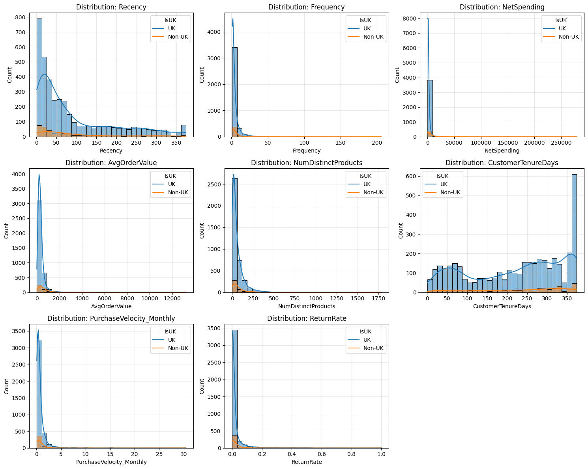
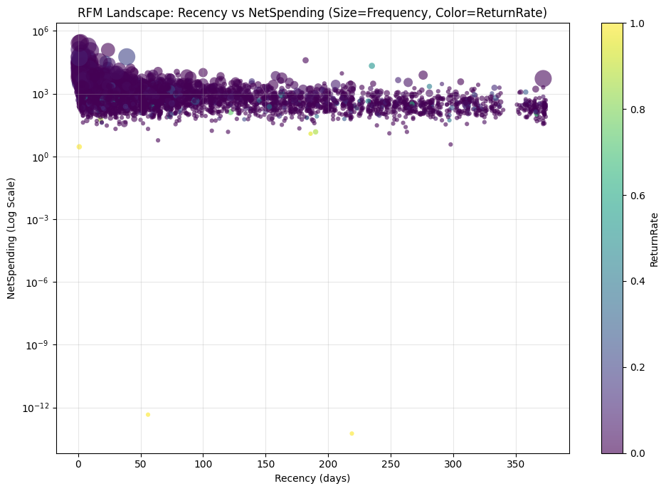
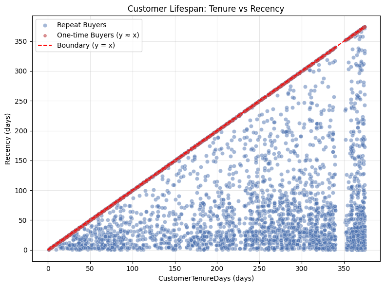
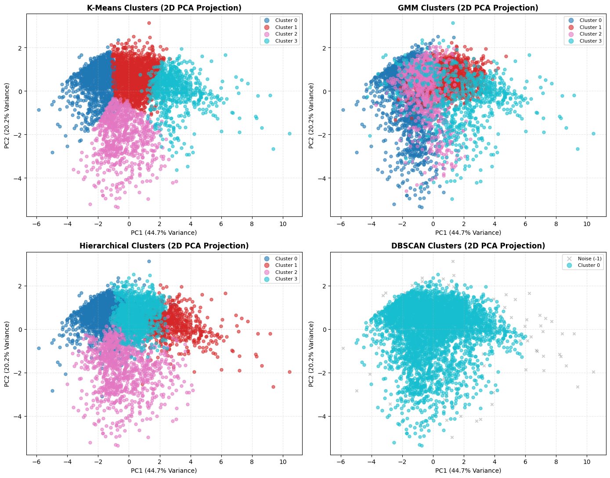
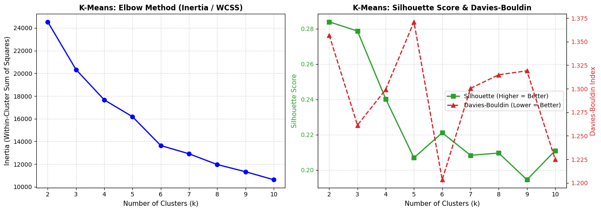
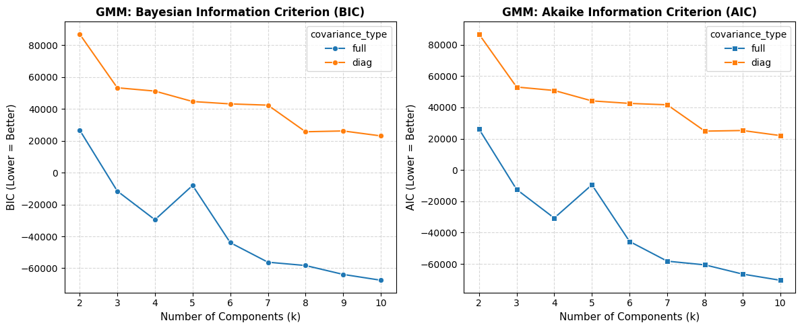
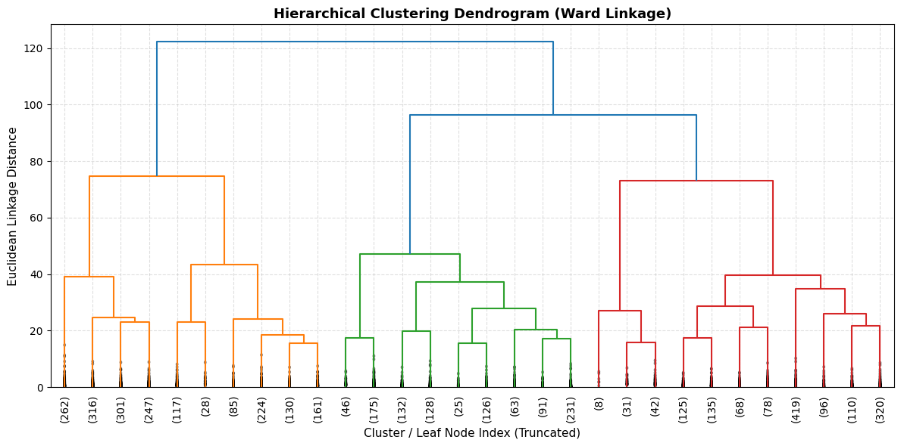
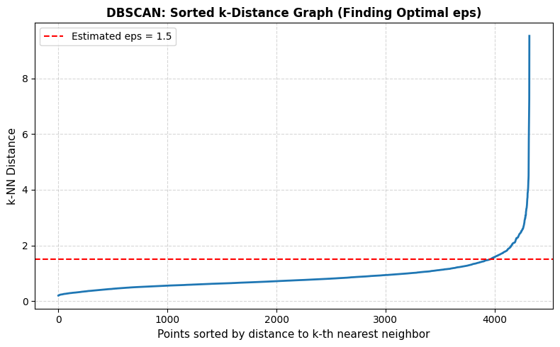
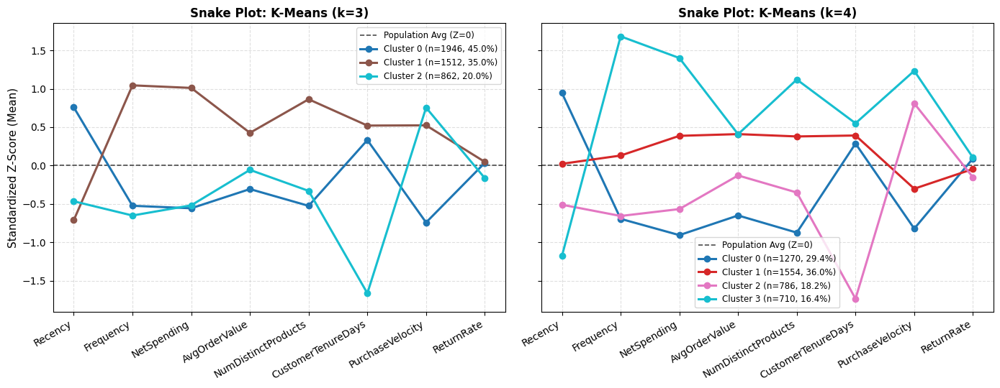
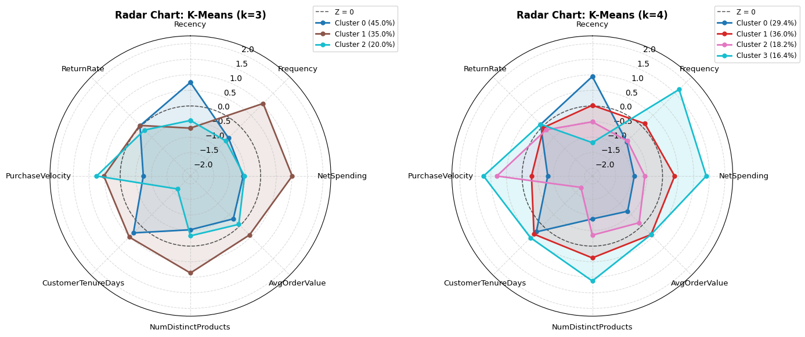

# Customer Segmentation

A customer segmentation pipeline on the Online Retail transaction dataset using extended RFM modeling, exploratory data analysis, and feature engineering to prepare customer representations for unsupervised clustering and subsequent customer profiling.

---

## 1. Project Overview

The objective of this project is to segment customers of an online retail platform into distinct, actionable behavioral cohorts. The source dataset comprises 404,876 cleaned transaction records spanning 21,785 orders and 4,362 unique customer identifiers from European online retail operations.

Rather than clustering raw, unaggregated transaction rows, the pipeline establishes a structured customer-level feature store. It incorporates core RFM metrics (Recency, Frequency, Monetary value) along with basket volume, product variety, customer tenure, order velocity, and return behavior.

```
data/cleaned/retail_online.parquet (Transaction level)
   │
   ▼
src/feature_engineering.py (extract_customer_features)
   │
   ▼
notebook/eda.ipynb (Distribution analysis, collinearity audit, log transformation, PCA, scaling)
   │
   ├─► data/clustered/customer_scaled.parquet (Scaled feature matrix for clustering)
   └─► data/clustered/customer_raw_profiling.parquet (Unscaled real-world metrics for profiling)
```

---

## 2. Exploratory Data Analysis and Key Insights

All visual evidence referenced below is generated in `notebook/eda.ipynb` and archived in the `img/` directory.

### Geographic Structure and Domestic Dominance
- The United Kingdom accounts for 90.4% of unique customers, 89.9% of invoices, and 82.3% of total revenue.
- Non-UK accounts exhibit an Average Order Value of 664.14, nearly 1.9 times higher than UK accounts (348.45). International buyers tend to consolidate orders into larger baskets to offset cross-border freight costs.
- Decision: Because behavioral patterns are structurally similar across territories aside from basket scale, geographic origin is retained as an auxiliary profiling flag (`IsUK`) rather than splitting the dataset into separate models.

### Feature Distributions and Skewness



- Raw spending, frequency, and quantity features exhibit severe right-skewness. Median net spending is 300.50, whereas wholesale accounts in the tail reach 278,778.02.
- Outliers in these features represent genuine B2B and institutional accounts rather than data collection errors. Dropping or winsorizing upper percentiles would discard the business's most valuable customer tier.
- Interquartile ranges on raw scales collapse near zero, leaving distance-based algorithms vulnerable to tail domination.

### Multicollinearity Audit


- A Spearman rank correlation matrix identified redundant metrics:
  - `NetSpending` and `GrossSpending` share a correlation of r = 0.99.
  - Return metrics (`ReturnRate`, `ReturnedAmount`, `CancelFrequency`) correlate at r = 0.99 to 1.00.
  - Basket measures `AvgOrderValue` and `AvgItemsPerOrder` correlate at r = 0.82.
- Decision: Prune `GrossSpending`, `ReturnedAmount`, `CancelFrequency`, and `AvgItemsPerOrder` from the clustering feature set to prevent artificial overweighting of monetary and return dimensions in Euclidean distance calculations.

### Distortion in Raw Feature Space


- Standardized raw features produce an unviable PCA projection: over 98% of customers collapse into an undifferentiated cluster at the origin, while a handful of wholesale accounts stretch PC1 beyond 40 and PC2 beyond 25.
- Decision: Distance-based clustering (such as K-Means or Hierarchical Clustering) cannot be executed on raw features without variance stabilization.

### Log-Transformation and Scale Normalization


- Applying `log1p(clip(lower=0))` compresses extreme tails and normalizes feature distributions:
  - `NetSpending` skewness decreases from 19.34 to 0.36.
  - `AvgOrderValue` skewness decreases from 36.38 to 0.01 (near-Gaussian symmetry).
  - `NumDistinctProducts` skewness decreases from 6.57 to -0.24.
  - `Frequency` and `PurchaseVelocity_Monthly` skewness drop to 1.21 and 1.61, respectively.
- Decision: Substitute all continuous raw metrics with their `_log1p` counterparts, followed by `StandardScaler`.

### Revenue Concentration


- Revenue concentration exceeds the standard 80/20 rule: the top 27.8% of customers generate 80% of cumulative net revenue, while the top 10% account for nearly half of total sales.
- Decision: Downstream cluster profiles must isolate and characterize this high-value minority for dedicated retention strategies.

### RFM Value Distribution


- Active buyers (`Recency < 50` days) account for virtually all accounts with net spending above 10,000 and high order frequency.
- Customers with `Recency > 200` days consist almost exclusively of low-frequency accounts with spending below 500, indicating churn.
- Elevated return rates exist across both single-order buyers and high-spending wholesale accounts.

### Customer Lifespan Geometry


- Plotting `CustomerTenureDays` against `Recency` reveals customer lifecycle stages:
  - The upper diagonal (`y = x`) contains one-time buyers whose tenure equals their recency.
  - The lower triangle contains repeat purchasers.
  - The lower-right corner (`Tenure > 300`, `Recency < 30`) captures long-term loyalists.
  - The middle zone (`Tenure > 150`, `Recency > 100`) captures lapsed accounts.
- Decision: Retain both `CustomerTenureDays` and `Recency` representations to allow clustering algorithms to distinguish account maturity from recent engagement.

### Return Behavior


- Return behavior is zero-inflated: 63.6% of customers have zero returns.
- Among the 36.4% who return, the majority exhibit a low frictional return rate (< 5% of gross spending). A narrow tail displays severe return rates between 30% and 100%.
- Decision: Retain `ReturnRate_log1p` transformed into `ReturnRate_scaled` as the relative return metric to separate high-risk returners from high-volume accounts with routine returns.

### Buyer Typologies


- Mapping product variety (`NumDistinctProducts`) against order item volume (`AvgItemsPerOrder`) uncovers four structural profiles:
  - Retail buyers: low catalog diversity and low unit counts.
  - Bulk wholesalers: narrow catalog selection with high unit volumes.
  - Assortment retailers: broad catalog diversity (> 50 SKUs) in moderate order quantities.
  - Enterprise distributors: both broad catalog coverage and large volume orders.

---

## 3. Dimensionality Reduction on Final Features

Applying PCA to the 8 selected log-transformed features produces an interpretable, non-degenerate latent space:

- Variance explained:
  - PC1: 42.6%
  - PC2: 22.6%
  - PC1 and PC2 together account for 65.2% of total variance; 3 components capture over 80%.
- Latent component semantics:
  - PC1 (Engagement and Scale): High positive loadings on `NetSpending_log1p` (0.51), `Frequency_log1p` (0.47), `NumDistinctProducts_log1p` (0.44), `PurchaseVelocity_Monthly_log1p` (0.30), and `AvgOrderValue_log1p` (0.29); negative loading on `Recency_log1p` (-0.38).
  - PC2 (Account Maturity vs. Purchasing Speed): Positive loadings on `CustomerTenureDays_log1p` (0.68) and `Recency_log1p` (0.37); negative loading on `PurchaseVelocity_Monthly_log1p` (-0.56).
  - Orthogonal Return Dimension: `ReturnRate_log1p` carries near-zero weight on PC1 (-0.02) and PC2 (0.05), loading into PC3. Return propensity operates independently of account value and maturity.

---

## 4. Preprocessing and Boundary Cleanup Decisions

1. Floating-point precision cleanup:
   Calculations of `NetSpending = GrossSpending - ReturnedAmount` were rounded to 2 decimal places. This removes accounts with net spend on the order of 1e-14 resulting from 100% cancellation rates, enforcing the intended `NetSpending > 0` filter.
2. Order velocity denominator stabilization:
   In `PurchaseVelocity_Monthly = Frequency / (CustomerTenureDays / 30.4375)`, tenure in months is clipped at a lower bound of 1.0 month. This prevents single-purchase accounts created in the final days of observation from displaying artificial velocity spikes of 30+ orders per month.
3. Outlier treatment:
   Outliers in RFM features represent real commercial buyers. Rather than dropping or clipping upper tails, features are stabilized via `np.log1p` and subsequently scaled via `StandardScaler`, ensuring cluster boundaries reflect natural business segments.
4. Key preservation:
   `CustomerID` is retained in all processed datasets as a primary key to allow cluster labels to be mapped directly back to unscaled transaction metrics during customer profiling.

---

## 5. Exported Datasets

The final step in `notebook/eda.ipynb` exports two dedicated Parquet files to `data/clustered/` to support both algorithm training and business profiling:

### Clustering Feature Matrix (`data/clustered/customer_scaled.parquet`)
Contains 4,320 customer rows with `CustomerID` and 8 standardized features ($\mu = 0, \sigma = 1$):
- `CustomerID`: Unique identifier used for cluster label mapping
- `Recency_scaled`: Standardized recency after `log1p`
- `Frequency_scaled`: Standardized frequency after `log1p`
- `NetSpending_scaled`: Standardized net revenue after `log1p`
- `AvgOrderValue_scaled`: Standardized average order value after `log1p`
- `NumDistinctProducts_scaled`: Standardized distinct SKU count after `log1p`
- `CustomerTenureDays_scaled`: Standardized relationship lifespan after `log1p`
- `PurchaseVelocity_Monthly_scaled`: Standardized monthly order velocity after `log1p`
- `ReturnRate_scaled`: Standardized return rate after `log1p`

### Profiling Feature Matrix (`data/clustered/customer_raw_profiling.parquet`)
Contains 4,320 customer rows with `CustomerID` and 12 unscaled, real-world metrics. This file is retained so that cluster cohorts can be summarized using actual business units (GBP currency, order counts, days, percentages) without distortion:
- `CustomerID`: Unique customer key
- `Recency`: Unscaled days since last order
- `Frequency`: Unscaled count of completed orders
- `NetSpending`: Unscaled net revenue in GBP
- `AvgOrderValue`: Unscaled average order value in GBP
- `NumDistinctProducts`: Unscaled unique catalog items purchased
- `CustomerTenureDays`: Unscaled account lifespan in days
- `PurchaseVelocity_Monthly`: Unscaled expected monthly order rate
- `ReturnRate`: Unscaled return proportion in $[0, 1]$
- `GrossSpending`: Total invoiced revenue prior to returns
- `ReturnedAmount`: Total monetary value of returned products
- `CancelFrequency`: Count of return/cancellation invoices
- `IsUK`: Domestic UK account flag (1 = UK, 0 = Non-UK)

---

## 6. Unsupervised Clustering and Model Evaluation

All clustering experiments, evaluation routines, and visual projections are implemented in `src/clustering/` and executed in `notebook/clustering.ipynb`.

### Algorithm Benchmarking at K = 4
Four unsupervised paradigms were trained on the 8 standardized features: K-Means, Agglomerative Hierarchical Clustering (Ward linkage), Gaussian Mixture Models (GMM with full covariance), and DBSCAN (`eps = 1.5`, `min_samples = 10`).



| Algorithm | Clusters (k) | Noise (%) | Silhouette | Davies-Bouldin | Calinski-Harabasz | Min Cluster Size (%) | Max Cluster Size (%) |
| :--- | :---: | :---: | :---: | :---: | :---: | :---: | :---: |
| K-Means | 4 | 0.00% | 0.2403 | 1.2992 | 1376.3 | 16.44% | 35.97% |
| Hierarchical | 4 | 0.00% | 0.1729 | 1.4833 | 1090.2 | 17.25% | 33.15% |
| GMM | 4 | 0.00% | 0.0740 | 2.7201 | 661.5 | 16.69% | 34.28% |
| DBSCAN | 1 | 3.33% | NaN | NaN | NaN | 96.67% | 96.67% |

- K-Means achieves the highest Silhouette score (0.2403), the lowest Davies-Bouldin index (1.2992), and the highest Calinski-Harabasz index (1376.3), delineating clear Voronoi partitions across the four quadrants of the latent space.
- Hierarchical Clustering identifies the same four macroscopic regions but yields jagged, overlapping boundaries near transition zones due to greedy agglomeration.
- GMM suffers from severe visual overlap on the 2D PCA plane because full-covariance ellipsoids align with the orthogonal return rate dimension (PC3) rather than customer scale and lifecycle maturity.
- DBSCAN collapses 96.67% of accounts into a single connected core cluster because purchasing behaviors form a continuous density gradient without sparse gaps. Tightening `eps` discards up to 45% of active customers as noise.
- Decision: Select K-Means as the primary segmentation engine. Repurpose DBSCAN noise (-1) as an auxiliary `Is_Anomaly` indicator to audit wholesale outliers and extreme returners.

### Parameter Tuning and Convergence Checks





- K-Means: Inertia decreases steadily from K = 2 to 10. The Davies-Bouldin index reaches a local optimum at K = 4 (1.2992), outperforming K = 3 (1.3512).
- GMM: AIC and BIC decrease monotonically, driven by fitting non-Gaussian tails and zero-inflated return distributions rather than structural cohorts.
- Hierarchical: The dendrogram exhibits two major vertical distance gaps: distance ~86 (K = 2) and distance ~35 to ~53 (K = 3 to 4). Merges below distance 25 compress into micro-subdivisions.
- DBSCAN: The sorted 10-NN distance curve remains flat below 1.2 across 95% of accounts before curving upward at the knee point of 1.5, isolating 144 anomaly points.

### Optimal K Selection: K = 3 vs. K = 4 Comparison
To determine whether K = 4 provides genuine commercial differentiation over K = 3, cluster profiles were analyzed across all 8 standardized dimensions using Snake Plots and Polar Radar Charts.




- Behavioral divergence: Transitioning from K = 3 to K = 4 does not produce parallel slices. Instead, it resolves the broad middle tier of K = 3 into two distinct trajectories that cross at `AvgOrderValue`:
  - Cluster 1 (Core Loyal): Reaches an Average Order Value Z-score of +0.41 (median 345 GBP), matching the basket value of VIPs (Cluster 3, median 354 GBP). However, order frequency remains moderate (median 3 orders) and monthly velocity dips below average (Z = -0.30).
  - Cluster 0 (Churned): Completely collapses across all commercial value metrics (Net Spending Z = -0.91, Avg Order Value Z = -0.65, Recency Z = +0.95).
- Geometric footprint: Radar charts confirm that K = 4 forms four distinct directional polygons: Cluster 3 expands across all spending and volume axes; Cluster 1 anchors the high order value and tenure spokes; Cluster 0 extends purely north along Recency; and Cluster 2 extends west along Purchase Velocity.
- Decision: Finalize K = 4 as the production segmentation model.

---

## 7. Customer Cohort Profiles and Strategic Recommendations

Profiles were quantified on unscaled metrics (`customer_raw_profiling.parquet`) for the 4,320 accounts:

### Cluster 3: VIP / Champions (16.44% of customers, n = 710)
- Revenue contribution: 64.40% of total net revenue (5,341,128.48 GBP).
- Behavioral profile: Median Recency = 9 days, Frequency = 10 orders, Net Spending = 3,541.35 GBP, Avg Order Value = 354.34 GBP, Distinct Products = 123 SKUs, Customer Tenure = 339 days, Velocity = 0.99 orders/month, Return Rate = 1.1%.
- Strategic action: High-touch account management, dedicated wholesale pricing tiers, priority fulfillment, and early catalog access. Routine operational returns should not trigger friction.

### Cluster 1: Core Loyal / At-Risk Frequency (35.97% of customers, n = 1,554)
- Revenue contribution: 26.92% of total net revenue (2,233,186.20 GBP).
- Behavioral profile: Median Recency = 52 days, Frequency = 3 orders, Net Spending = 1,068.75 GBP, Avg Order Value = 345.02 GBP, Distinct Products = 58 SKUs, Customer Tenure = 282 days, Velocity = 0.40 orders/month, Return Rate = 0.0%.
- Strategic action: Automated reorder triggers at the 45-60 day mark, personalized cross-selling from complementary catalog categories (expanding beyond 58 SKUs), and volume-based loyalty milestones to accelerate ordering cadence into Cluster 3.

### Cluster 2: Newly Acquired / Promising Trials (18.19% of customers, n = 786)
- Revenue contribution: 4.43% of total net revenue (367,236.46 GBP).
- Behavioral profile: Median Recency = 26 days, Frequency = 1 order, Net Spending = 298.53 GBP, Avg Order Value = 230.98 GBP, Distinct Products = 16 SKUs, Customer Tenure = 43 days, Velocity = 1.00 order/month, Return Rate = 0.0%.
- Strategic action: Structured 30-60-90 day onboarding communication, time-limited second-purchase incentives, and starter product bundles to convert one-time trial purchasers into repeat buyers.

### Cluster 0: Churned / Low-Value Hibernating (29.40% of customers, n = 1,270)
- Revenue contribution: 4.25% of total net revenue (352,382.78 GBP).
- Behavioral profile: Median Recency = 199 days, Frequency = 1 order, Net Spending = 212.13 GBP, Avg Order Value = 171.60 GBP, Distinct Products = 13 SKUs, Customer Tenure = 208 days, Velocity = 0.14 orders/month, Return Rate = 0.0%.
- Strategic action: Restrict marketing expenditure to low-cost seasonal clearance campaigns (Q4 holiday promotions). Exclude from high-cost direct sales or paid acquisition retargeting.

---

## 8. Repository Structure

```
customer-segmentation/
├── data/
│   ├── cleaned/
│   │   └── retail_online.parquet           # Cleaned transaction logs
│   ├── clustered/
│   │   ├── customer_scaled.parquet         # Standardized matrix for clustering
│   │   └── customer_raw_profiling.parquet  # Unscaled metrics for profiling
│   ├── online_retail.xlsx                  # Raw dataset
│   └── README.md                           # Data documentation
├── img/
│   ├── img1.png to img10.png               # EDA visual evidence
│   └── Clustering/
│       ├── img1.png                        # K-Means evaluation metrics (K=2..10)
│       ├── img2.png                        # GMM AIC/BIC curves (full vs. diag)
│       ├── img3.png                        # Hierarchical Ward dendrogram
│       ├── img4.png                        # DBSCAN k-distance knee plot
│       ├── img5.png                        # 4-algorithm 2D PCA cluster projections
│       ├── img6.png                        # Snake Plot comparison (k=3 vs. k=4)
│       └── img7.png                        # Polar Radar Chart comparison (k=3 vs. k=4)
├── notebook/
│   ├── cleaning.ipynb                      # Transaction-level data cleaning
│   ├── eda.ipynb                           # Feature engineering, EDA, scaling, export
│   └── clustering.ipynb                    # Algorithm benchmarking and optimal K selection
├── src/
│   ├── clustering/                         # Clustering package
│   │   ├── algorithms.py                   # K-Means, GMM, Hierarchical, DBSCAN runners
│   │   ├── evaluation.py                   # Metrics calculation and range evaluations
│   │   ├── visualization.py                # Metric curves, PCA, Snake, and Radar plots
│   │   └── __init__.py                     # Package interface
│   ├── feature_engineering.py              # Customer aggregation and transformation
│   └── visualization.py                    # EDA plotting and PCA utilities
├── .gitignore
└── README.md                               # Project documentation
```

---

## 9. Next Steps: Customer Profiling and Decision Rules

1. Data merging: Join K-Means labels (K = 4) and DBSCAN anomaly flags (`Is_Anomaly`) with `data/clustered/customer_raw_profiling.parquet` to produce `customer_segmented.parquet`.
2. Dedicated profiling module: Implement `src/profiling/` to generate segment summary tables, revenue distribution donuts, and anomaly diagnostics.
3. Rule extraction: Train a surrogate decision tree classifier on the final segments to produce human-interpretable segmentation thresholds for deployment into production CRM workflows.
