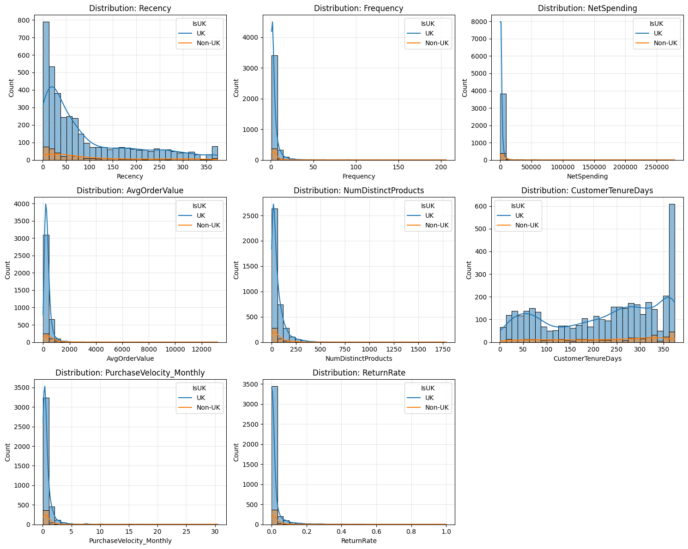
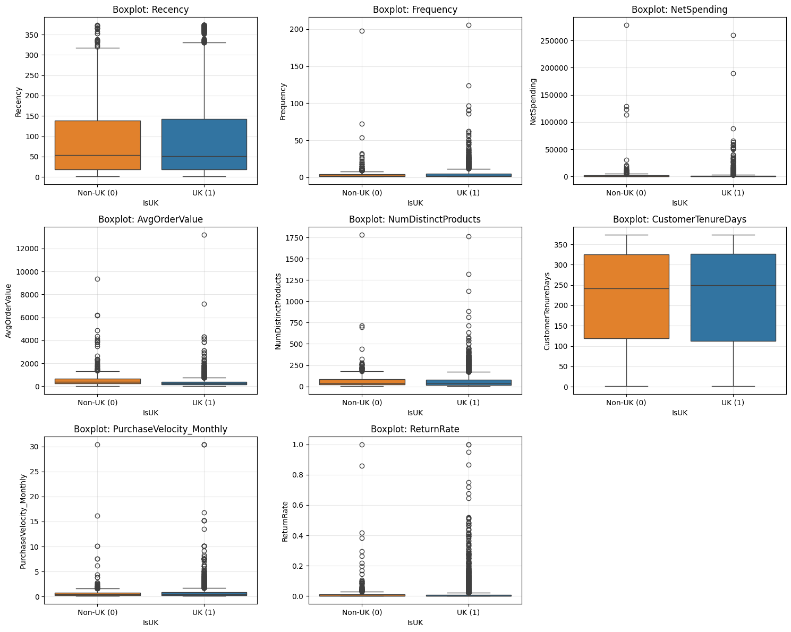
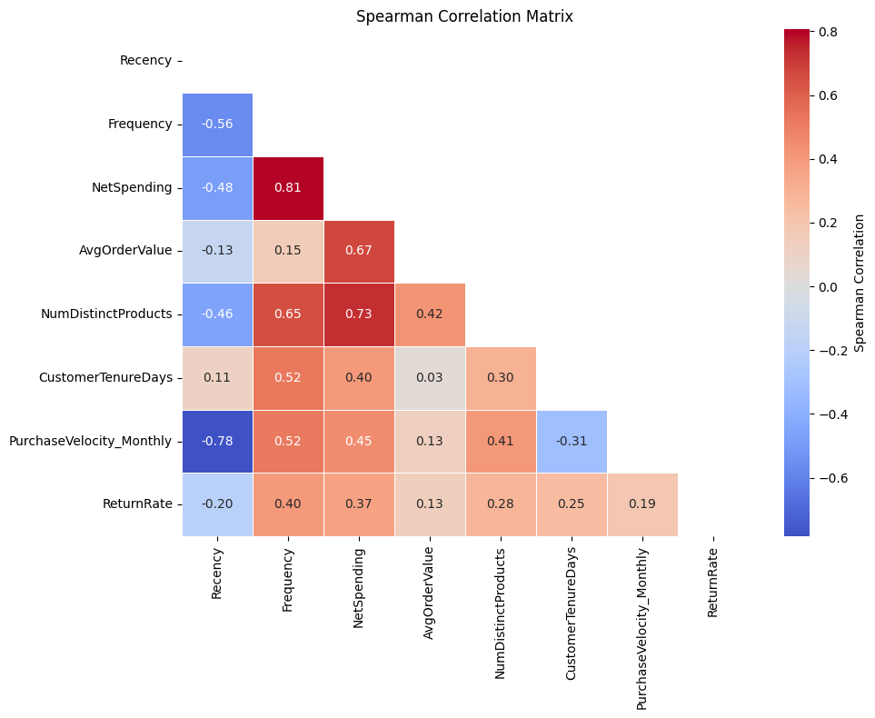
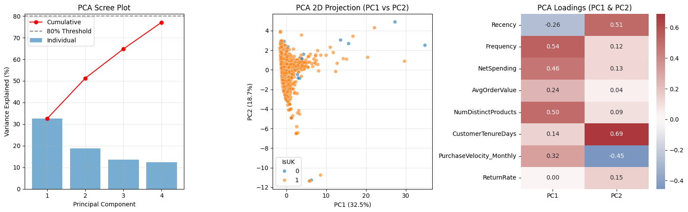
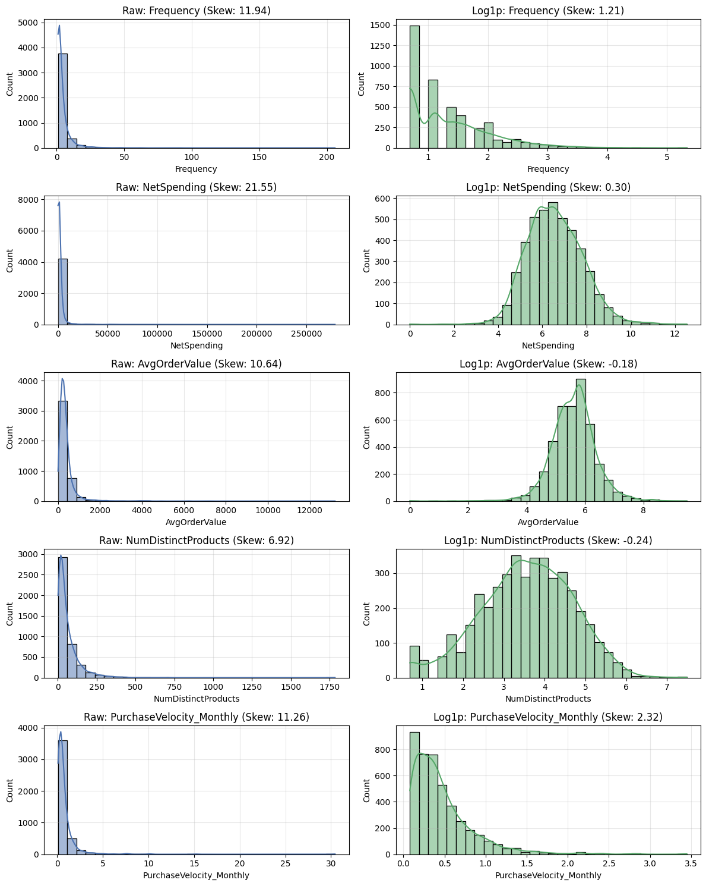
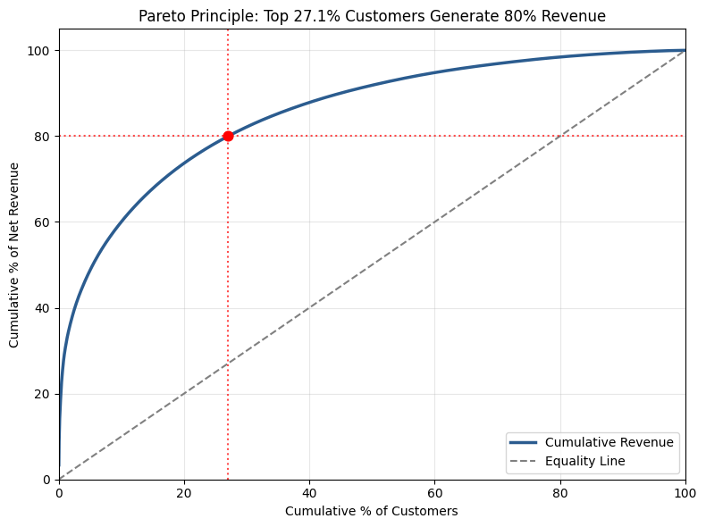
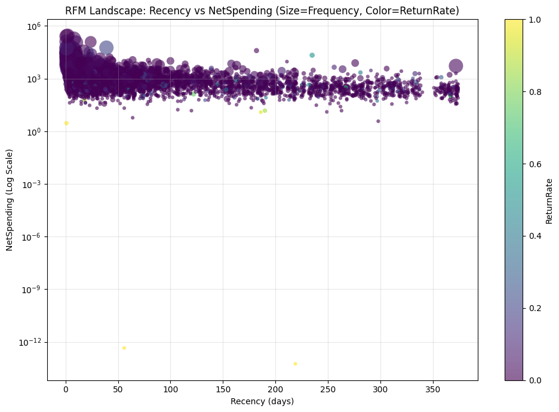
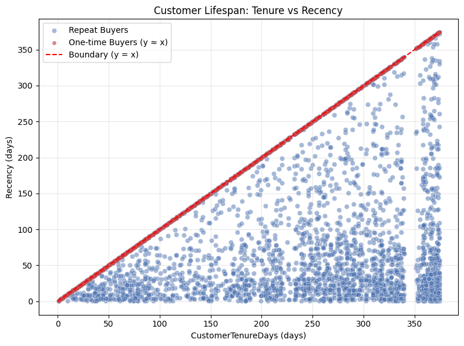
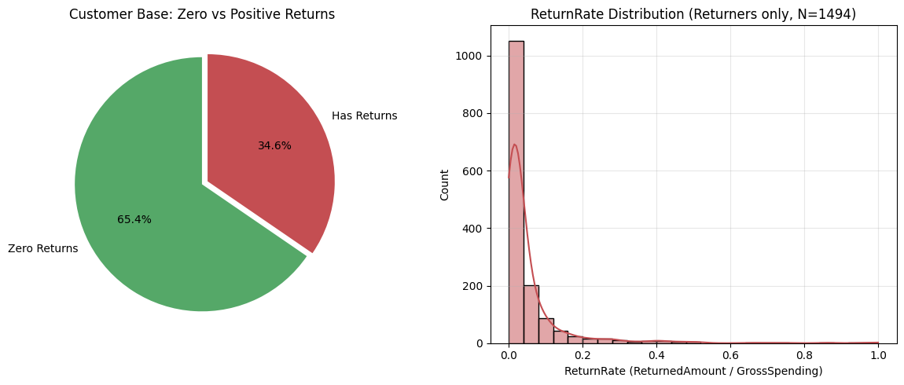
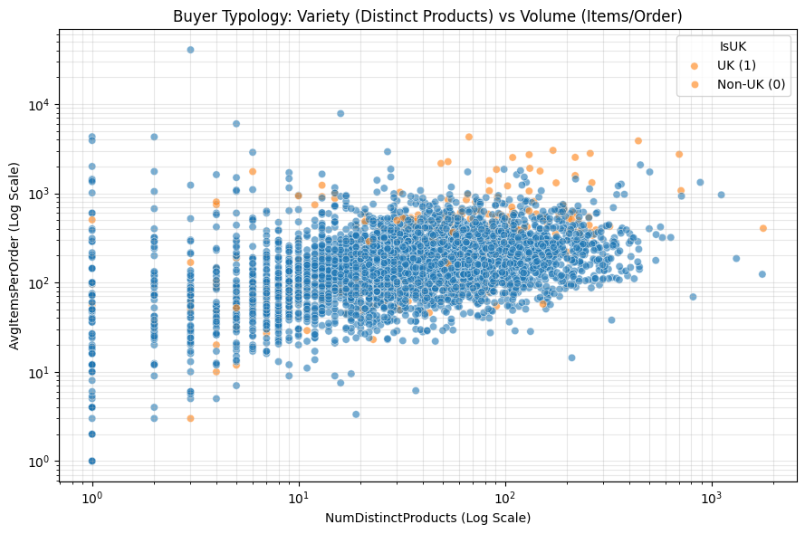

# Customer Segmentation

A customer segmentation pipeline on the Online Retail transaction dataset using extended RFM modeling, exploratory data analysis, and feature engineering to prepare customer representations for unsupervised clustering.

---

## 1. Project Overview

The objective of this project is to segment customers of an online retail platform into distinct, actionable behavioral cohorts. The source dataset comprises 404,876 cleaned transaction records spanning 21,785 orders and 4,362 unique customer identifiers from European online retail operations.

Rather than clustering raw, unaggregated transaction rows, the pipeline establishes a structured customer-level feature store. It incorporates core RFM metrics (Recency, Frequency, Monetary value) along with basket volume, product variety, customer tenure, order velocity, and return behavior.

```
data/cleaned/retail_online.parquet (Transaction level)
   │
   ▼
src/feature_engineering.py (extract_customer_features)
   │
   ▼
notebook/eda.ipynb (Distribution analysis, collinearity audit, log transformation, PCA)
   │
   ▼
data/clustered/retail_online.parquet (Customer-level feature matrix for clustering)
```

---

## 2. Exploratory Data Analysis and Key Insights

All visual evidence referenced below is generated in `notebook/eda.ipynb` and archived in the `img/` directory.

### Geographic Structure and Domestic Dominance
- The United Kingdom accounts for 90.4% of unique customers, 89.9% of invoices, and 82.3% of total revenue.
- Non-UK accounts exhibit an Average Order Value of 664.14, nearly 1.9 times higher than UK accounts (348.45). International buyers tend to consolidate orders into larger baskets to offset cross-border freight costs.
- Decision: Because behavioral patterns are structurally similar across territories aside from basket scale, geographic origin is retained as an auxiliary profiling flag (`IsUK`) rather than splitting the dataset into separate models.

### Feature Distributions and Skewness



- Raw spending, frequency, and quantity features exhibit severe right-skewness. Median net spending is 300.50, whereas wholesale accounts in the tail reach 278,778.02.
- Outliers in these features represent genuine B2B and institutional accounts rather than data collection errors. Dropping or winsorizing upper percentiles would discard the business's most valuable customer tier.
- Interquartile ranges on raw scales collapse near zero, leaving distance-based algorithms vulnerable to tail domination.

### Multicollinearity Audit


- A Spearman rank correlation matrix identified redundant metrics:
  - `NetSpending` and `GrossSpending` share a correlation of r = 0.99.
  - Return metrics (`ReturnRate`, `ReturnedAmount`, `CancelFrequency`) correlate at r = 0.99 to 1.00.
  - Basket measures `AvgOrderValue` and `AvgItemsPerOrder` correlate at r = 0.82.
- Decision: Prune `GrossSpending`, `ReturnedAmount`, `CancelFrequency`, and `AvgItemsPerOrder` from the clustering feature set to prevent artificial overweighting of monetary and return dimensions in Euclidean distance calculations.

### Distortion in Raw Feature Space


- Standardized raw features produce an unviable PCA projection: over 98% of customers collapse into an undifferentiated cluster at the origin, while a handful of wholesale accounts stretch PC1 beyond 40 and PC2 beyond 25.
- Decision: Distance-based clustering (such as K-Means or Hierarchical Clustering) cannot be executed on raw features without variance stabilization.

### Log-Transformation and Scale Normalization


- Applying `log1p(clip(lower=0))` compresses extreme tails and normalizes feature distributions:
  - `NetSpending` skewness decreases from 19.34 to 0.36.
  - `AvgOrderValue` skewness decreases from 36.38 to 0.01 (near-Gaussian symmetry).
  - `NumDistinctProducts` skewness decreases from 6.57 to -0.24.
  - `Frequency` and `PurchaseVelocity_Monthly` skewness drop to 1.21 and 1.61, respectively.
- Decision: Substitute all continuous raw metrics with their `_log1p` counterparts prior to standardization.

### Revenue Concentration


- Revenue concentration exceeds the standard 80/20 rule: the top 27.8% of customers generate 80% of cumulative net revenue, while the top 10% account for nearly half of total sales.
- Decision: Downstream cluster profiles must isolate and characterize this high-value minority for dedicated retention strategies.

### RFM Value Distribution


- Active buyers (`Recency < 50` days) account for virtually all accounts with net spending above 10,000 and high order frequency.
- Customers with `Recency > 200` days consist almost exclusively of low-frequency accounts with spending below 500, indicating churn.
- Elevated return rates exist across both single-order buyers and high-spending wholesale accounts.

### Customer Lifespan Geometry


- Plotting `CustomerTenureDays` against `Recency` reveals customer lifecycle stages:
  - The upper diagonal (`y = x`) contains one-time buyers whose tenure equals their recency.
  - The lower triangle contains repeat purchasers.
  - The lower-right corner (`Tenure > 300`, `Recency < 30`) captures long-term loyalists.
  - The middle zone (`Tenure > 150`, `Recency > 100`) captures lapsed accounts.
- Decision: Retain both `CustomerTenureDays_log1p` and `Recency_log1p` to allow clustering algorithms to distinguish account maturity from recent engagement.

### Return Behavior


- Return behavior is zero-inflated: 63.6% of customers have zero returns.
- Among the 36.4% who return, the majority exhibit a low frictional return rate (< 5% of gross spending). A narrow tail displays severe return rates between 30% and 100%.
- Decision: Use `ReturnRate_log1p` as the sole relative return metric to separate high-risk returners from high-volume accounts with routine returns.

### Buyer Typologies


- Mapping product variety (`NumDistinctProducts`) against order item volume (`AvgItemsPerOrder`) uncovers four structural profiles:
  - Retail buyers: low catalog diversity and low unit counts.
  - Bulk wholesalers: narrow catalog selection with high unit volumes.
  - Assortment retailers: broad catalog diversity (> 50 SKUs) in moderate order quantities.
  - Enterprise distributors: both broad catalog coverage and large volume orders.

---

## 3. Dimensionality Reduction on Final Features

Applying PCA to the 8 selected log-transformed features produces an interpretable, non-degenerate latent space:

- Variance explained:
  - PC1: 42.6%
  - PC2: 22.6%
  - PC1 and PC2 together account for 65.2% of total variance; 3 components capture over 80%.
- Latent component semantics:
  - PC1 (Engagement and Scale): High positive loadings on `NetSpending_log1p` (0.51), `Frequency_log1p` (0.47), `NumDistinctProducts_log1p` (0.44), `PurchaseVelocity_Monthly_log1p` (0.30), and `AvgOrderValue_log1p` (0.29); negative loading on `Recency_log1p` (-0.38).
  - PC2 (Account Maturity vs. Purchasing Speed): Positive loadings on `CustomerTenureDays_log1p` (0.68) and `Recency_log1p` (0.37); negative loading on `PurchaseVelocity_Monthly_log1p` (-0.56).
  - Orthogonal Return Dimension: `ReturnRate_log1p` carries near-zero weight on PC1 (-0.02) and PC2 (0.05), loading into PC3. Return propensity operates independently of account value and maturity.

---

## 4. Preprocessing and Boundary Cleanup Decisions

1. Floating-point precision cleanup:
   Calculations of `NetSpending = GrossSpending - ReturnedAmount` were rounded to 2 decimal places. This removes accounts with net spend on the order of 1e-14 resulting from 100% cancellation rates, enforcing the intended `NetSpending > 0` filter.
2. Order velocity denominator stabilization:
   In `PurchaseVelocity_Monthly = Frequency / (CustomerTenureDays / 30.4375)`, tenure in months is clipped at a lower bound of 1.0 month. This prevents single-purchase accounts created in the final days of observation from displaying artificial velocity spikes of 30+ orders per month.
3. Outlier treatment:
   Outliers in RFM features represent real commercial buyers. Rather than dropping or clipping upper tails, features are stabilized via `np.log1p`, ensuring cluster boundaries reflect natural business segments.

---

## 5. Final Feature Matrix for Clustering

The final dataset for clustering is exported to:

`data/clustered/retail_online.parquet`

The matrix contains 4,360 customer records and 8 normalized features:

| Feature Name | Source Concept | Transformation | Role in Clustering |
| :--- | :--- | :--- | :--- |
| `Recency_log1p` | Days since last purchase | `log1p` | Churn and recency status |
| `Frequency_log1p` | Total completed orders | `log1p` | Purchase frequency and loyalty |
| `NetSpending_log1p` | Gross spend minus returns | `log1p` | Customer monetary value |
| `AvgOrderValue_log1p` | Net spending per order | `log1p` | Basket expenditure level |
| `NumDistinctProducts_log1p` | Unique product codes purchased | `log1p` | Breadth of product interest |
| `CustomerTenureDays_log1p` | Days since first purchase | `log1p` | Customer relationship lifespan |
| `PurchaseVelocity_Monthly_log1p` | Monthly order rate | `log1p` | Purchasing intensity over tenure |
| `ReturnRate_log1p` | Returned amount / Gross spend | `log1p` | Operational return risk |

---

## 6. Repository Structure

```
customer-segmentation/
├── data/
│   ├── cleaned/
│   │   └── retail_online.parquet      # Cleaned transaction logs
│   ├── clustered/
│   │   └── retail_online.parquet      # Prepared customer feature matrix
│   ├── online_retail.xlsx             # Raw dataset
│   └── README.md                      # Data documentation
├── img/
│   ├── img1.png to img10.png          # Visualizations generated during EDA
├── notebook/
│   ├── cleaning.ipynb                 # Transaction-level data cleaning
│   └── eda.ipynb                      # Feature engineering, EDA, and export
├── src/
│   ├── feature_engineering.py         # Customer aggregation and transformation
│   └── visualization.py               # Plotting and PCA utilities
├── .gitignore
└── README.md                          # Project documentation
```

---

## 7. Next Steps: Clustering Phase

With the feature matrix finalized, the next phase proceeds to:
1. Feature scaling via `StandardScaler`.
2. Cluster number determination using the Elbow Method, Silhouette Analysis, and Davies-Bouldin Index.
3. Model evaluation comparing K-Means, Gaussian Mixture Models (GMM), and Hierarchical Agglomerative Clustering.
4. Business profiling, cluster labeling, and persona interpretation.
